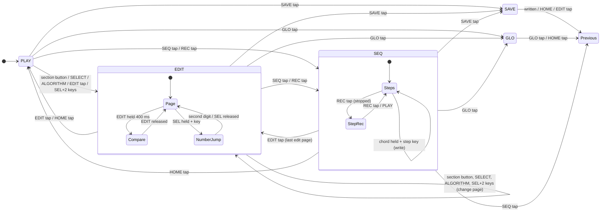

# On-device UI: interaction model

Status: proposal for #39, with Eric's decisions of 2026-11-10 applied
([section 10](#10-decisions-eric-2026-11-10)).
Owner: UX lead (interaction). The UI Designer owns colors, type and mockups,
which come from the screen content lists in [section 6](#6-screen-content-requirements).

This doc says what each control does in each state, what the screen must
show, and which behaviors the tests check. It does not say how anything
looks.

## 1. The inspiration, and the rules

fm1-8p is inspired by mid-80s two-oscillator polysynths, and the JX-8P in
particular. That synth had no knob per parameter. You called a parameter by
its number, name and value showed on the display, and one
data-entry control changed it. An optional programmer gave each parameter its
own control. Parameters were grouped by section: the two oscillators, the
mixer, the filter, the amp, two envelopes, the LFO and the chorus.

fm1-8p keeps that feel:

- **Every patch parameter has a two-digit number.** The tens digit is the
  section (1..8) and the units digit is the parameter (1..8). The numbers are
  fm1-8p's own.
- **A page is four parameters on KNOB1-4,** like a strip of a hardware
  programmer. Each section has one or two pages: units 1-4 are page A and
  units 5-8 are page B.
- **The last parameter you touched is the "focus".** The screen shows it
  large: its number, name and value. This is the one-parameter display from
  the original, and the other three knobs on the page are always live.
- **There are three ways to get to a section quickly:** a section button, the
  ALGORITHM encoder (one section per detent), or typing the number on the keys.

Rules for everything on the device: no Roland logos or panel artwork, and no
Roland product name. The one exception is the patches: the JX-8P's 32 factory
tones ship with their factory names (Eric's decision in #75; see
[docs/patches.md](../patches.md)). On the device
the sections are called DCO-1, DCO-2, MIX, VCF, VCF ENV, VCA, LFO and CTRL.
Those are generic synth terms. Chorus modes are named SLOW, DEEP and FAST,
not numbered the way the original's were.

## 2. The hardware this uses

From fm1-dock `hb_module.h` (ABI 2). fm1-8p registers with
`HB_F_SCREEN | HB_F_PANEL`:

- **`HB_F_SCREEN`:** the whole 240 x 240 screen is fm1-8p's.
- **`HB_F_PANEL`:** the keys arrive as events, so the sequencer can use them,
  and so do OCT- and OCT+. fm1-8p gives OCT- and OCT+ their usual meaning
  (octave down or up, reported to the host with `key_base`).
- **HOME:** a short press is fm1-8p's (back to PLAY). Holding it for 1.5 s
  still opens the host's module picker, and fm1-8p gets the release first.

| Control | Kind | Notes |
| --- | --- | --- |
| FX, SEL, ENV, LFO, EDIT, GLO, SAVE, ARP, SEQ, PLAY, REC | buttons | each has an LED: 0 off, 1 lit, 2 glow (dim) |
| SELECT, ALGORITHM, KNOB1-4, PRESETS | endless encoders | relative clicks, + is clockwise; \|clicks\| >= 3 in one event is a fast turn |
| 27 keys, F3..G5 (key 0..26) | keys | velocity where force is sensed (else 0), aftertouch, one LED each |
| OCT-, OCT+ | buttons | octave, -3..+3 |
| HOME | button | tap: PLAY state; hold 1.5 s: host picker |

The FM-1 has **no bend or mod wheel**. Live bend and mod come only from
MIDI in (pitch bend and CC1). On the panel, they are set per step in the
sequencer.

ARP is **not assigned** in this version. It is kept for the arpeggiator
issue, and its LED stays off.

## 3. Parameter map

Each row gives the number, then page and knob, the engine parameter, the
on-screen label, the value as shown, the step per click, and the fast step.
A fast step is used when one event carries 3 or more clicks.

- **"Pending":** the parameter comes from an open PR or issue. Its knob and
  number are reserved now, so the map does not change when it lands. Until
  then the screen shows `--` and the knob does nothing.

**Pending on main at `d1c50e6`** (checked 2026-11-10). Everything else in the
map is live in `engine/fm1_8p.h` and `engine/params.c`.

| Slots | Waits for |
| --- | --- |
| 25, 26 | #58 (pitch envelope) |
| 46 | #8, its second PR (filter velocity) |
| 47 | #33 (DCO-2 envelope level) |
| 48 | #59 (filter envelope source and invert) |
| 55 | #60 (envelope key follow) |
| 66 | #60 (envelope key follow) |
| 67 | #63 (amp gate mode) |
| 68 | #61 (aftertouch) |
| 76 | #8, its second PR (LFO to cutoff) |
| 77 | #61 (aftertouch) |
| 78 | #61, after 76 lands |
| 85-86 | #41 (mod wheel) |
| 87 | #41, after 76 lands |
| 88 | #62 (portamento) |

A pending slot shows `--` until it lands. What each slot will show then is
in [Pending slots, once they land](#pending-slots-once-they-land).

- **"Reserved":** the slot is empty. It shows nothing and the knob does
  nothing.

### 1x DCO-1 (page 1A)

| No. | Knob | Engine parameter | Label | Shown as | Step / fast |
| --- | --- | --- | --- | --- | --- |
| 11 | K1 | `osc1_wave` | WAVE | SAW, PULSE, SQUARE, NOISE | 1 / 1 |
| 12 | K2 | `osc1_octave` | RANGE | 32', 16', 8', 4', 2' (octave -2..+2; 8' = 0) | 1 / 1 |
| 13 | K3 | `osc1_fine_cents` | FINE | -100..+100 ct | 1 / 10 |
| 14 | K4 | `osc1_pulse_width_pct` | WIDTH | 1..99 % (shown inactive unless WAVE is PULSE) | 1 / 5 |

### 2x DCO-2 (pages 2A and 2B)

| No. | Knob | Engine parameter | Label | Shown as | Step / fast |
| --- | --- | --- | --- | --- | --- |
| 21 | K1 | `osc2_wave` | WAVE | as 11 | 1 / 1 |
| 22 | K2 | `osc2_octave` | RANGE | as 12 | 1 / 1 |
| 23 | K3 | `osc2_fine_cents` | FINE | as 13 | 1 / 10 |
| 24 | K4 | `osc2_pulse_width_pct` | WIDTH | as 14 | 1 / 5 |
| 25 | K1 | pitch envelope amount (pending, #58) | P.ENV | -- | - |
| 26 | K2 | pitch envelope target (pending, #58) | P.ENV> | -- | - |
| 27-28 | K3-K4 | reserved | | | |

### 3x MIX (page 3A)

| No. | Knob | Engine parameter | Label | Shown as | Step / fast |
| --- | --- | --- | --- | --- | --- |
| 31 | K1 | `osc_mix_permille` | MIX | `D1 70 : 30 D2` (0..100, 1 = 10 per mille) | 1 / 5 |
| 32 | K2 | `osc_sync` | SYNC | OFF, ON | 1 / 1 |
| 33 | K3 | `osc_xmod_permille` | X-MOD | 0..100 % | 1 / 5 |
| 34 | K4 | `osc2_coarse_semis` | COARSE | -12..+12 st | 1 / 1 |

### 4x VCF (pages 4A and 4B)

46 and 47 are pending on their own issues.

| No. | Knob | Engine parameter | Label | Shown as | Step / fast |
| --- | --- | --- | --- | --- | --- |
| 41 | K1 | `filter_cutoff_cents` | CUTOFF | Hz, 3 significant digits (8.18 Hz .. 33.5 kHz); `OPEN` at 14400 | 100 ct / 400 ct |
| 42 | K2 | `filter_resonance_permille` | RESO | 0..100 (100 self-oscillates) | 1 / 5 |
| 43 | K3 | `filter_env_amount_cents` | ENV | -96..+96 st | 1 st / 6 st |
| 44 | K4 | `filter_key_track_permille` | KEY | 0..100 % | 1 / 10 |
| 45 | K1 | `highpass_step` | HPF | OFF, 100 Hz, 240 Hz, 560 Hz | 1 / 1 |
| 46 | K2 | filter velocity amount (pending, #8) | VEL | -- | - |
| 47 | K3 | DCO-2 envelope level (pending, #33) | D2 ENV | -- | - |
| 48 | K4 | filter envelope source (pending, #59) | ENV SRC | -- | - |

### 5x VCF ENV (pages 5A and 5B)

| No. | Knob | Engine parameter | Label | Shown as | Step / fast |
| --- | --- | --- | --- | --- | --- |
| 51 | K1 | `filter_env_attack_ms` | ATTACK | time (see below) | time table |
| 52 | K2 | `filter_env_decay_ms` | DECAY | time | time table |
| 53 | K3 | `filter_env_sustain_permille` | SUSTAIN | 0..100 | 1 / 5 |
| 54 | K4 | `filter_env_release_ms` | RELEASE | time | time table |
| 55 | K1 | envelope 1 key follow (pending, #60) | KEY | -- | - |
| 56-58 | K2-K4 | reserved | | | |

### 6x VCA (pages 6A and 6B)

| No. | Knob | Engine parameter | Label | Shown as | Step / fast |
| --- | --- | --- | --- | --- | --- |
| 61 | K1 | `amp_attack_ms` | ATTACK | time | time table |
| 62 | K2 | `amp_decay_ms` | DECAY | time | time table |
| 63 | K3 | `amp_sustain_permille` | SUSTAIN | 0..100 | 1 / 5 |
| 64 | K4 | `amp_release_ms` | RELEASE | time | time table |
| 65 | K1 | `amp_velocity_pct` | VEL | 0..100 % | 1 / 5 |
| 66 | K2 | envelope 2 key follow (pending, #60) | KEY | -- | - |
| 67 | K3 | amp gate mode (pending, #63) | AMP | -- | - |
| 68 | K4 | aftertouch to VCA (pending, #61) | AT>VCA | -- | - |

### 7x LFO (pages 7A and 7B)

| No. | Knob | Engine parameter | Label | Shown as | Step / fast |
| --- | --- | --- | --- | --- | --- |
| 71 | K1 | `lfo_wave` | WAVE | TRI, SAW, SQUARE, RANDOM | 1 / 1 |
| 72 | K2 | `lfo_rate_centihz` | RATE | 0.01..30.0 Hz, 3 significant digits | rate table |
| 73 | K3 | `lfo_delay_ms` | DELAY | time, 0..5.00 s | time table |
| 74 | K4 | `lfo_pitch_cents` | PITCH | 0..1200 ct | 1 to 99 ct: 1 / 10; then 10 / 50 |
| 75 | K1 | `lfo_pw_pct` | PW | 0..49 % | 1 / 5 |
| 76 | K2 | LFO to cutoff depth (pending, #8) | VCF | -- | - |
| 77 | K3 | aftertouch to vibrato (pending, #61) | AT>VIB | -- | - |
| 78 | K4 | aftertouch to cutoff (pending, #61, and with 76 on #8) | AT>VCF | -- | - |

### 8x CTRL (pages 8A and 8B)

| No. | Knob | Engine parameter | Label | Shown as | Step / fast |
| --- | --- | --- | --- | --- | --- |
| 81 | K1 | `chorus_mode` | CHORUS | OFF, SLOW, DEEP, FAST | 1 / 1 |
| 82 | K2 | `voice_mode` | MODE | POLY, UNISON | 1 / 1 |
| 83 | K3 | `unison_detune_cents` | DETUNE | 0..100 ct (inactive in POLY) | 1 / 10 |
| 84 | K4 | `bend_range_semitones` | BEND | 0..24 st | 1 / 2 |
| 85 | K1 | wheel adds to vibrato (pending, #41) | W>PITCH | -- | - |
| 86 | K2 | wheel adds to PW (pending, #41) | W>PW | -- | - |
| 87 | K3 | wheel adds to cutoff (pending, #41, and with 76 on #8) | W>VCF | -- | - |
| 88 | K4 | portamento time (pending, #62) | PORTA | -- | - |

### Pending slots, once they land

Until its issue lands, each of these slots shows `--` and its knob sends
nothing (test 12). When it lands, its row in the map above takes these values:

| No. | Label | Shown as | Step / fast |
| --- | --- | --- | --- |
| 25 | P.ENV | -24..+24 st | 1 st / 4 st |
| 26 | P.ENV> | BOTH, D2 | 1 / 1 |
| 46 | VEL | 0..100 % | 1 / 5 |
| 48 | ENV SRC | ENV1, ENV1 INV, ENV2, ENV2 INV | 1 / 1 |
| 55 | KEY | 0..100 % | 1 / 10 |
| 66 | KEY | 0..100 % | 1 / 10 |
| 67 | AMP | ENV, GATE | 1 / 1 |
| 68 | AT>VCA | 0..100 % | 1 / 5 |
| 77 | AT>VIB | same unit as 74 | as 74 |
| 78 | AT>VCF | same unit as 76 (once 76 has landed too) | as 76 |
| 85 | W>PITCH | same unit as 74 | as 74 |
| 86 | W>PW | same unit as 75 | as 75 |
| 87 | W>VCF | same unit as 76 (once 76 has landed too) | as 76 |
| 88 | PORTA | time, 0..10.0 s; 0 shows `OFF` | time table |

### Units and value tables

- **Time:** the engine stores ms. The screen shows `0 ms` .. `999 ms`, then
  `1.00 s` .. `9.99 s`, then `10.0 s` .. `32.0 s`. A knob click moves one entry in a
  fixed table of about 115 entries from 0 to the parameter's maximum (32000 ms
  for every envelope time, as a JX-8P ATTACK runs to about 34 s, as long as the patch
  table's int16 holds), spaced about
  7 % apart above 20 ms: 0, 1, 2, 3, 4, 5, 6, 8, 10, 12, 15, 18, 20, 22 ... 32000. A fast
  turn moves 4 entries. A value that is not in the table, from MIDI or an
  older patch, snaps to the nearest entry on the first click, in the direction
  of the turn.
- **DECAY and RELEASE times are time constants** (#99): the decay and release are
  exponential, as on PG-8X, and the screen shows their tau, the time the
  distance to the target takes to fall to 37 % (-8.7 dB). The level is down
  20 dB at 2.3 x the shown time and 40 dB at 4.6 x. A release ends (the voice
  is free) at -80 dB, 9.2 x the shown time. ATTACK stays the time to the peak.
  This changed what a stored DECAY or RELEASE means: a patch saved before it
  plays its decay and release slower and longer (fine before release; no
  patches have shipped).
- **LFO rate:** the same idea, a table from 0.01 Hz to 30.0 Hz, about 6 %
  apart.
- **Cutoff:** shown as Hz from `8.18 * 2^(cents/1200)`, three significant
  digits (`440 Hz`, `1.25 kHz`, `12.0 kHz`). At the top of the range, 14400 ct
  (`FM_FILTER_OPEN_CENTS`, the maximum of `filter_cutoff_cents` in
  `engine/params.c` on main), it shows `OPEN`.
- **The engine's value is the truth.** Values between steps, which only MIDI
  or an older patch can set, show as their nearest rounded value. Nothing
  rewrites them until a knob turns them.
- **Fast turns:** a fast step applies when one event has \|clicks\| >= 3. Each
  click then moves by the fast step. Smaller events move by the normal step
  per click.
- **Clamping:** at the end of a range the value stays put. Encoders never wrap
  a parameter's value. They do wrap pages and sections.

### Page order

The SELECT encoder walks the pages in number order, and wraps at both ends:

`1A, 2A, 2B, 3A, 4A, 4B, 5A, 5B, 6A, 6B, 7A, 7B, 8A, 8B` (14 pages)

**Pages with nothing live are skipped.** The SELECT walk and the section
button rings skip a page whose slots are all pending or reserved. The page
joins them once one of its slots is live. Today that skips 2B (25-28), 5B
(55-58) and 8B (85-88). A number jump to a slot on a skipped page still shows
that page (test 7), and the screen's page position still counts all 14.

ALGORITHM jumps by section (1..8, wrapping) to the section's page A.

## 4. Buttons and encoders

### Section buttons (in PLAY and EDIT)

Each section button owns a ring of pages. Its **first press** goes to the
ring's first page. Pressing it **again while on its ring** goes to the next
page in the ring, and wraps. The button's LED is lit while one of its pages
is shown, and glows otherwise.

| Button | Ring | Why |
| --- | --- | --- |
| SEL | 1A DCO-1, 2A DCO-2, 2B DCO-2 (once live), 3A MIX | the oscillators: "select the source" |
| ENV | 4A VCF, 4B VCF, 5A VCF ENV, 5B VCF ENV (once live), 6A VCA, 6B VCA | the filter and amp, with their envelopes |
| LFO | 7A LFO, 7B LFO, 8B WHEEL (once live) | modulation |
| FX | 8A CTRL (chorus, voice mode, bend) | the output end |

VCF is the most-edited section, so it comes first on ENV, and the PLAY
screen's knobs are a VCF shortcut too (see [PLAY](#play-the-home-state)).

### Number jump (the original's "call a parameter by number")

In PLAY or EDIT:

1. Hold SEL and tap two white keys.
2. The eight white keys from F3 to F4 (F3, G3, A3, B3, C4, D4, E4, F4) are the
   digits 1..8. While SEL is held, keys make no sound, and those eight key
   LEDs glow as a keypad.
3. After the second digit, fm1-8p goes to that parameter's page and makes it
   the focus.
4. A number with no parameter (a reserved slot) goes to its page, the focus is
   empty, and the screen shows `NO PARAMETER`.
5. Releasing SEL after one digit goes to that section's page A.
6. A SEL tap, pressed and released in under 400 ms with no key in between, is
   the ring step from the table above. It acts on release.

### EDIT: edit page and compare

- **EDIT tap** (under 400 ms):
  - in PLAY: goes to the last edit page shown (4A the first time);
  - in EDIT: goes back to PLAY;
  - in SEQ: goes to the last edit page while the sequencer keeps running.
- **EDIT hold** (400 ms or more), in PLAY or EDIT: **compare**.
  - While it is held, the stored patch sounds and the screen shows its values.
  - Knobs are ignored, and a turn shows `COMPARE: RELEASE EDIT TO CHANGE`.
  - Releasing EDIT puts the edit buffer back, exactly as it was.
  - With no edits, a hold shows `NO EDITS` and changes nothing.
- **EDIT LED:** lit while the edit buffer differs from the stored patch. It
  blinks during compare, and glows when there are no edits.

### PRESETS: patch browsing

- **In PLAY and EDIT:** each click loads the next or previous patch at once
  (a fast turn moves 4). Patch numbers wrap. The page you are on stays, so you
  can compare a section across patches.
- **Unsaved edits:** when the edit buffer is modified, the first PRESETS
  **event** does not load anything, whatever its click count (a fast +4 warns
  just like +1). It shows `EDITED: TURN AGAIN TO DISCARD`.
  - A **later** event in the same direction while the warning shows (1.5 s)
    discards the edits and loads, moving by that event's clicks.
  - Anything else cancels the warning (decision Q4).
- **The edit buffer survives power-off** (decision Q4). It is kept with the
  module's settings, in the settings record if it fits in 240 bytes and in a
  flash bank otherwise. Flash wears out, so it is written only:
  - when the module is released; or
  - once the buffer has gone 10 s with no change since the last edit.

  It is never written while any voice sounds or the sequencer plays; a write
  that is due then waits for silence. The same rule covers the pattern edit
  buffer.
- **In SAVE:** PRESETS picks the destination slot.
- **In GLO:** PRESETS browses patches as in PLAY.
- **In SEQ view:** PRESETS browses **patterns**, not patches. See
  [Pattern slots](#pattern-slots).

### Patch numbering

- **User patches:** 64 slots numbered 11..88, two digits 1..8 each, like the
  parameter numbers (11..18, 21..28, ... 81..88).
- **Starter patches (#14):** a separate read-only group, shown with a `P`
  prefix (`P1`, `P2`, ...). PRESETS goes through the user slots 11..88, then
  the P group, then wraps.
- A starter patch can be edited and saved to a user slot. SAVE never offers a P
  slot as the destination.
- **Program change mapping**, the same for receive and send (G23):
  - PC 0..63 map to slots 11..88 in order: PC 0 = 11, PC 1 = 12 ... PC 7 = 18,
    PC 8 = 21 ... PC 63 = 88. In other words, slot = 11 + 10 x (PC / 8) +
    (PC mod 8).
  - PC 64 and up are the P group: PC 64 = P1, PC 65 = P2, and so on.
  - A received PC past the last P patch is ignored.
  - With SEND or BOTH, loading a patch on the panel sends its PC by the same
    mapping.
  - Patterns have no program change.

### SAVE

SAVE saves the **patch** from PLAY and EDIT, and the **pattern** from SEQ
view. The flow is the same for both; only the slots differ.

1. **SAVE tap** in PLAY or EDIT opens SAVE for the patch. In SEQ view it opens
   SAVE for the pattern.
   - The destination starts at the current slot.
   - The name is the current one.
2. **In SAVE:**
   - PRESETS: the destination slot (patch 11..88, or pattern 11..88). It
     shows the name of what is there now, or `EMPTY`.
   - SELECT: moves the name cursor.
   - KNOB1: the character at the cursor (A-Z, 0-9, space, `-`).
   - KNOB2: inserts or deletes at the cursor. Clockwise inserts a space, and
     counterclockwise deletes.
   - PLAY, OCT-, OCT+ and the keys work as usual, so the sound can be played
     while naming it. Their LEDs follow their usual rules.
   - Every other button does nothing in SAVE, and its LED is off.
3. **SAVE tap again** writes the patch. If the destination holds another
   patch, the first tap shows `REPLACE 23 <NAME>? SAVE AGAIN`, and the second
   tap writes.
4. **After the write:** it shows `SAVED 23` (or `SAVED PATTERN 23`) for 1.5 s,
   that edit buffer becomes clean, and the state goes back to where SAVE was
   pressed.
5. **Cancel:** HOME tap or EDIT tap. Nothing is written.
6. **A write erases a flash bank,** which stalls the sound for about 100 ms.
   - **Waiting:** if any voice is sounding or the sequencer is playing, the
     write waits.
     - A **snapshot** of the patch (or pattern), its name and its destination
       is taken at the confirming tap.
     - The state goes back to where SAVE was pressed, and every screen shows
       `SAVING WHEN SILENT` until the write happens.
     - The snapshot is written on the first silent moment. Edits, a program
       change or a patch or pattern change while waiting do not change what is
       written.
   - **Force:** holding SAVE for 1 s or more while `SAVING WHEN SILENT` shows
     writes the snapshot at once, accepting the dropout (decision Q5). A SAVE
     tap then does nothing; it does not open a second SAVE.
   - **Cancel:** the first HOME tap while a write is waiting cancels it. It
     shows `SAVE CANCELED` and does nothing else.
   - **After the write:** the edit buffer is clean only if it still equals the
     snapshot. Otherwise EDITED stays.
   - A failed write shows `SAVE FAILED` and keeps the edit buffer dirty.

A patch never includes a pattern, and a pattern never includes a sound
(decision Q2).

### GLO: global settings

GLO holds settings for the instrument, not for a patch. They are kept in the
module's settings record, and saved 2 s after the last change once nothing
is sounding, as fm1-dock's rules ask.

- GLO tap opens GLO. GLO tap or HOME tap goes back to the previous state.
- SELECT and ALGORITHM move between the GLO pages, and KNOB1-4 edit them.
- Numbers have a `G` prefix so they are never confused with patch
  parameters.

| No. | Knob | Setting | Shown as | Default |
| --- | --- | --- | --- | --- |
| G11 | K1 | MIDI channel in | 1..16, ALL | ALL |
| G12 | K2 | MIDI channel out | 1..16 | 1 |
| G13 | K3 | Clock source | AUTO, INT, MIDI | AUTO |
| G14 | K4 | Clock out | OFF, ON | OFF |
| G21 | K1 | CC receive | OFF, ON | ON |
| G22 | K2 | CC send (knob moves go out as CC) | OFF, ON | OFF |
| G23 | K3 | Program change | OFF, RECV, SEND, BOTH | RECV |
| G24 | K4 | External CC response | JUMP, PICKUP | JUMP (decision Q6) |
| G31 | K1 | Velocity curve (the host's `sense_set` curve) | 50..200 % | the host's |
| G32 | K2 | Fixed velocity, for keys with no force sensing | 1..127 | 100 |
| G33 | K3 | Key LEDs follow played notes | OFF, ON | ON |
| G34 | K4 | Theme | MEMBRANE, NIGHT PANEL | NIGHT PANEL |

**Theme (G34):** the screen's look for the whole instrument, not per patch.
It takes effect at once, redrawing the whole screen, and is saved with the
other GLO settings. The UI Designer owns what each theme looks like. The
interaction model is the same in both.

**Clock source:**

- **AUTO:** follows MIDI clock when it arrives, and goes back to the internal
  clock after it stops (the behavior #38 builds).
- **INT:** ignores MIDI clock.
- **MIDI:** only MIDI clock. With no clock coming in, the sequencer waits.

### Transport and sequencer buttons

PLAY, SEQ and REC are described in [section 5](#5-sequencer).

OCT- and OCT+ shift the keys by an octave, in every state. That includes REC
step entry, where the octave sets the pitch that is written.

### Encoders summary

| Encoder | PLAY | EDIT | SEQ | SAVE | GLO |
| --- | --- | --- | --- | --- | --- |
| SELECT | page (goes to EDIT) | page | step cursor | name cursor | GLO page |
| ALGORITHM | section (goes to EDIT) | section | SEQ page | - | GLO page |
| KNOB1-4 | performance knobs | page's parameters | SEQ page's values | K1 char, K2 insert/delete | settings |
| PRESETS | patch | patch | pattern | destination slot | patch |

## 5. Sequencer

This follows #35-#42: 16 steps, and each step holds a note, a chord (up to the
voice count), a tie or a rest. Each step also has a velocity, a bend and mod
value, and a jump or glide move.

### The split keyboard (decision Q1)

**Outside SEQ view, all 27 keys play notes.** In SEQ view the keyboard splits:

| Keys | In SEQ view |
| --- | --- |
| 0-15, F3..G#4 (black and white, in a row) | **step keys**, steps 1-16. They make no sound. |
| 16-26, A4..G5 (11 keys) | **chord keys**. They play notes, as do MIDI notes in. |

- **Chord keys follow the octave:** OCT- and OCT+ shift them as usual. With
  the octave at -2, they play A2..G3, so chords in any register are reachable.
- **MIDI notes in count as held chord keys.** A chord can come from a MIDI
  keyboard as well as the top 11 keys.
- **Every key remembers how it started.** A key held when SEQ view opens or
  closes still releases the way it began (see
  [Keys that change meaning while held](#keys-that-change-meaning-while-held)).

### Key LEDs

Step keys 0-15 in SEQ view:

| Step | LED |
| --- | --- |
| past the pattern length | off |
| rest or empty, within the length | glow |
| note or chord | lit |
| tie | lit, with a short off blink every 500 ms |
| cursor (stopped, or in REC) | blinks between lit and glow at 4 Hz |
| playhead (playing) | the step's state inverted for the step's length: lit becomes off, glow or off becomes lit |

Chord keys 16-26 in SEQ view:

- **Glow:** the play zone, so the split is visible.
- **Lit:** while the key is held.

Outside SEQ view:

- **While the sequencer plays:** only the playhead step's key (0-15) is lit.
  Held notes are also lit if G33 is on.
- **When stopped:** held notes are lit if G33 is on, and everything else is
  off.

Button LEDs:

- **SEQ:** lit in SEQ view, and glows otherwise.
- **PLAY:** lit while playing, with a short dark flash on each beat. Glows
  when stopped. Blinks when it is waiting for external clock.
- **REC:** lit while step record is armed, and glows otherwise.

### SEQ view

The SEQ view's screen is a **piano roll**: steps across, pitch up and down. The
visual details are in PR #53. This doc gives its content (section 6) and its
controls.

SEQ tap goes to SEQ view. SEQ tap in SEQ view goes back to the state SEQ was
pressed from. In SEQ view:

- **SELECT** moves the step cursor (1..length, wraps), and the screen shows
  that step.
- **A step key with no chord held** moves the cursor to that step. While
  stopped and not in REC, it also plays the step's notes once, as an audition.
- **A step key with a chord held** writes the chord to that step and moves the
  cursor there (see [Writing steps](#writing-steps)).
- **PRESETS** browses patterns (see [Pattern slots](#pattern-slots)).
- **SAVE** saves the pattern.
- **ALGORITHM** picks the SEQ page:

| Page | K1 | K2 | K3 | K4 |
| --- | --- | --- | --- | --- |
| S1 PATTERN | TEMPO 30..300 BPM (step 1, fast 10) | LENGTH 1..16 | SWING 50..75 % | GATE 5..100 % |
| S2 STEP (the cursor's step) | VEL 1..127 | BEND -100..+100 % of the bend range (and the semitones it gives) | MOD 0..127 | MOVE JUMP, GLIDE |
| S3 PLAY | TRANSPOSE -24..+24 st | KEY TRANSPOSE OFF, ON | - | - |

- **Pattern settings are part of the pattern.** TEMPO, LENGTH, SWING and GATE
  are saved with it, and loading a pattern sets them. TRANSPOSE and KEY
  TRANSPOSE are performance settings and are not saved.
- **TEMPO under external clock:** TEMPO shows the measured tempo and
  `MIDI CLOCK`. Turning it shows `TEMPO FOLLOWS MIDI CLOCK` and changes
  nothing.
- **On a rest step,** S2 shows that step's values but marks them inactive.
  Rests and ties keep the bend and mod they had (#42).
- **Section buttons mean something else in SEQ view.** They are steps, not
  sections, and the screen labels them:

| Button | Not in REC | In REC (step record) |
| --- | --- | --- |
| SEL | clear the cursor step (make it a rest) | write a REST, advance |
| SEL held 1.5 s | clear the whole pattern (the saved copy stays until SAVE) | - |
| ENV | toggle TIE on the cursor step | write a TIE, advance |
| LFO | toggle JUMP or GLIDE on the cursor step | same |
| FX | unassigned | step back one step, without writing |

### Writing steps

There are two ways to write a step. Both use a **chord**: the chord keys and
MIDI notes held at that moment, with the octave applied. In both:

- **Note count:** only as many notes as the voice count are kept, the first
  ones pressed. The rest are dropped, and the screen shows `MAX n NOTES`, where
  n is the build's voice count (6 by default).
- **Velocity:** the highest velocity among the chord's notes. A key with no
  force sensing uses G32.
- **Bend and mod:** the live MIDI-in pitch bend and CC1 at the moment of
  writing (#42). With no MIDI controller, these are center and 0.

**1. Chord + step key (any time in SEQ view, playing or stopped):**

1. Hold a chord on the chord keys, or over MIDI. It sounds.
2. Press a step key. The chord is written to that step and the cursor moves
   there.
3. Still holding the chord, more step keys write the same chord to those steps
   too, which is quick for repeated chords.
4. Releasing the chord writes nothing more.

**2. Step record (REC, while stopped):**

1. **Arming:** REC tap while stopped arms step record. If you are not in SEQ
   view, it goes there. The cursor stays where it is, and the REC LED is lit.
   While playing, REC does nothing but show `STOP TO RECORD` (decision Q3), and
   its LED is off.
2. **Building a step:** play a note or chord on the chord keys or over MIDI.
   Each key down sounds and joins the step being built.
3. **Writing:** when the last held chord key or MIDI note is released, the
   step is written at the cursor and the cursor advances (and wraps at the
   length).
4. **Moving the cursor:** a step key with no chord held moves it, without
   writing or auditioning. A step key with a chord held writes the chord there
   at once, as in way 1, and the cursor then advances past it.
5. **Rests, ties and going back:** SEL writes a rest, ENV writes a tie, and FX
   steps back.
6. **Leaving:** REC tap disarms.
7. **PLAY while armed:** the sequencer starts and REC disarms, so a performance
   doesn't record over the pattern. There is no live recording while playing in
   this version (decision Q3).

### Pattern slots

Patterns have their own slots, separate from patches (decision Q2).

- **Numbering:** 64 user pattern slots numbered 11..88, two digits 1..8 each,
  like patches (decision Q9). The screen always says which kind: `PATCH 23`
  and `PATTERN 23` are different things.
- **Storage:** patterns are kept in their own flash banks. The format and size
  are #40's.
- **An empty slot loads as an empty pattern:** 16 rests, LENGTH 16, and the
  default TEMPO, SWING and GATE.
- **The pattern edit buffer** is the pattern being played and edited.
  - It is separate from the sound's edit buffer.
  - It has its own PATTERN EDITED marker.
  - It survives power-off the same way (decision Q4).
- **Browsing:** PRESETS in SEQ view.
  - **Stopped:** each click loads the next or previous pattern at once. With
    PATTERN EDITED, the first event warns `PATTERN EDITED: TURN AGAIN TO
    DISCARD`, per event as for patches.
  - **Playing:** the pattern doesn't change mid-pass. Clicks pick the **next
    pattern**, shown as `NEXT PATTERN 23`. It takes over when the running
    pattern ends its pass (after its last step).
  - Turning back to the running pattern's number cancels the next pattern.
  - With PATTERN EDITED, the warning comes first, as when stopped.
- **Saving:** SAVE in SEQ view, the same flow as a patch (see
  [SAVE](#save)).
- **Patch and pattern never change each other.**
  - A patch change, from PRESETS or a MIDI program change, changes only the
    sound, and the running pattern plays on (decision Q8).
  - A pattern change changes only the notes.

### Playing

- **PLAY** starts from step 1, or stops. It works in every state, including
  SAVE and GLO. It acts on **press**, not release, so it is on time.
- **Stopping:**
  - note-offs go out for everything the sequencer started;
  - bend returns to center and mod returns to the live wheel (#42);
  - a queued next pattern loads at once;
  - with G14 on, MIDI stop goes out.
- **Starting** sends MIDI start, with G14 on.
- **Clock source MIDI** (G13) or AUTO with clock present:
  - a PLAY press with no clock running arms the start: PLAY blinks, and the
    sequencer starts on the next MIDI start or continue;
  - a second press disarms.
  - MIDI start, stop and continue act as #38 says, whatever the PLAY LED shows.
- **Transpose:** S3 TRANSPOSE sets an offset, -24..+24 semitones.
  - With KEY TRANSPOSE on and the sequencer playing, played keys do not sound.
    They set the transpose to the **lowest** key held minus a reference C, at
    the next step (#37). The result is clamped to -24..+24.
  - **The reference C:**
    - outside SEQ view, C4 for panel keys;
    - in SEQ view, C5 (the only C among the chord keys) for panel keys;
    - for MIDI notes in, MIDI note 60 (C4), in any view.

    Panel keys use their pitch before the octave shift.
  - **Outside SEQ view** there are no step keys, so a key press transposes at
    once.
  - **In SEQ view, chord entry comes first:**
    - Chord keys and MIDI notes are held without sounding and decided when the
      last of them is released.
    - If a step key was pressed while any of them was held, it was chord
      entry: the chord was written at the step key, and nothing transposes.
    - If no step key was pressed, it is a transpose to the lowest key held,
      applied at the next step after the release.
  - Releasing the keys keeps the transpose.
  - When stopped, keys play normally.
- **Bend and mod per step (#42):**
  - JUMP steps set their bend and mod at the step start.
  - GLIDE steps ramp from the previous step's values to their own by the step
    end.
  - Live MIDI bend and CC1 still reach the engine while the sequencer plays;
    the newest value wins until the next step sets its own (decision Q7).

### Editing during playback

All of PLAY, EDIT, GLO and SEQ stay usable while the sequencer plays.

- **Sound edits** reach the engine at once. They are smoothed by #3.
- **Step edits:** an edit to a step (chord + step key, S2, SEL or ENV) takes
  effect the next time that step plays. A step that is sounding is not cut.
- **Pattern settings:**
  - LENGTH shorter than the playhead: the playhead wraps to step 1 at the next
    step.
  - TEMPO changes take effect at the next step.
  - SWING and GATE apply from the next step.

## 6. Screen content requirements

This is for the UI Designer. It lists what each state must show, in priority
order, and says nothing about the look. "Must" items are needed to use the
synth, and "should" items help.

Everywhere, unless the state says otherwise:

- **Must:** the current patch number and name (`PATCH 23`, or `P3` for a
  starter), with an EDITED marker when the edit buffer differs from the stored
  patch.
- **Must:** the current pattern number (`PATTERN 41`), with a PATTERN EDITED
  marker. While a next pattern is queued, also `NEXT PATTERN 23`.
- **Must:** a transport indicator: STOPPED, PLAYING with the step number, or
  WAITING FOR CLOCK. Also the clock source in use, INT or MIDI, and the tempo.
- **Must:** a banner line for short messages, shown 1.5 s:
  - `SAVED 23`, `SAVED PATTERN 23`
  - `EDITED: TURN AGAIN TO DISCARD`
  - `PATTERN EDITED: TURN AGAIN TO DISCARD`
  - `MAX n NOTES` (n = the build's voice count)
  - `SAVE CANCELED`
  - `STOP TO RECORD`
  - `NO EDITS`
  - `NO PARAMETER`
  - `SAVING WHEN SILENT`
  - `SAVE FAILED`
  - `TEMPO FOLLOWS MIDI CLOCK`
  - `COMPARE: RELEASE EDIT TO CHANGE`
  - `NEXT PATTERN 23`
- **Should:** the number of sounding voices, out of the voice count.
- **Should:** a MIDI-in activity mark that flashes for 100 ms on any message.

### PLAY (the home state)

- **Must:** the patch number and name, large.
- **Must:** the four performance knobs, each with its number, label and value:
  K1 41 CUTOFF, K2 42 RESO, K3 43 ENV, K4 64 RELEASE.
- **Must:** the focus readout (number, section, label, value) after a knob is
  turned, cleared after 3 s of no turns.
- **Should:** a hint that EDIT opens the edit pages and that section buttons
  jump to sections.

### EDIT (a parameter page)

- **Must:**
  - the section name and number (`4 VCF`);
  - the page (A or B) and how many pages the section has;
  - where the page sits in the full page order (for example, 5 of 14).
- **Must:** for each of the four knobs:
  - its number, label and value as shown in the map;
  - a marker for an inactive value (14 WIDTH when WAVE isn't PULSE, 83
    DETUNE in POLY);
  - `--` for a pending parameter, and nothing for a reserved one.
- **Must:** the focus parameter, large. This is the one-parameter display:
  number, section, full label and value, with its unit.
- **Should:** the focus value's position in its range, for any parameter that
  has a range rather than a list of choices.
- **Should:** the knob position on the page (K1..K4) next to each value, so
  the physical knob is obvious.
- **Must**, while SEL is held for a number jump:
  - the digits typed so far (`4_`);
  - the eight sections by number and name;
  - that the white keys F3-F4 are 1-8.
- **Must**, while EDIT is held for compare: a clear COMPARE marker, and the
  values shown are the stored patch's.

### SAVE

- **Must:**
  - whether a patch or a pattern is being saved;
  - the destination slot number;
  - the name currently in that slot, or EMPTY;
  - the new name with the cursor position;
  - the step: editing, confirm replace, waiting for silence, saved, or failed.
- **Must:** which controls do what: PRESETS for the slot, SELECT for the
  cursor, K1 for the character, K2 for insert or delete, SAVE to write, HOME to
  cancel.

### GLO

- **Must:** that this is the global page. Global settings are not part of the
  patch.
- **Must:** when G34 THEME changes, the whole screen (every state) redraws in
  the new theme at once.
- **Must:** the page and the four settings, each with its G-number, label and
  value.

### SEQ view

- **Must:** the pattern number and name, PATTERN EDITED, and the queued next
  pattern if there is one. In SEQ view, PRESETS changes this, not the patch.
- **Must:** a piano roll of the pattern (PR #53 has the visuals). It shows the
  notes of every step against pitch, along with the 16-step strip content
  below.
- **Must:** a 16-step strip. For each step: rest, note, chord or tie, and
  whether it is past the length. Also the cursor, and the playhead while
  playing. It mirrors the key LEDs.
- **Must:** the cursor step in detail:
  - its notes by name, `C4 E4 G4`, up to the voice count;
  - or REST or TIE;
  - its velocity, bend (% and semitones), mod, and JUMP or GLIDE.
- **Must:** the SEQ page (S1, S2 or S3) and its four knob values.
- **Must:** step record armed or not. While armed, the notes held so far for
  the step being built.
- **Must:** the chord held now on the chord keys and MIDI in, by note name,
  since pressing a step key writes it there.
- **Must:** that the keyboard is split: F3..G#4 are steps, A4..G5 play.
- **Must:** the meaning of SEL, ENV, LFO and FX in SEQ view (REST, TIE, MOVE,
  BACK), since it differs from the other states.
- **Must:** the transpose, when it isn't 0.
- **Should:** the tempo source and tempo next to the strip.

### Back from the host's picker

`draw(full)` redraws the whole state, and every LED is sent again. The state
is the one fm1-8p was in when it was left, but the sequencer is stopped:
`release()` cuts notes.

## 7. Navigation states

- **Previous** means the state that SEQ, SAVE or GLO was entered from.
- **Compare and number jump** also exist in PLAY, and work the same there.
- **The keyboard split** applies only in SEQ view: there, keys F3..G#4 are step
  keys and A4..G5 play. In every other state all keys play.
- **The transport** runs alongside every state: STOPPED, PLAYING, or
  WAITING-FOR-CLOCK. PLAY toggles it from any state.
- **HOME held 1.5 s** leaves fm1-8p for the host's picker from any state.

### What each button does in each state

| Button | PLAY | EDIT | SEQ | SAVE | GLO |
| --- | --- | --- | --- | --- | --- |
| SEL | tap: DCO ring; hold: number jump | same | REST or clear step; hold 1.5 s: clear pattern | - | - |
| ENV | VCF/VCA ring | same | TIE | - | - |
| LFO | LFO ring | same | JUMP or GLIDE | - | - |
| FX | CTRL page | same | BACK (in REC) | - | - |
| EDIT | tap: last edit page; hold: compare | tap: PLAY; hold: compare | tap: last edit page | cancel | - |
| GLO | GLO | GLO | GLO | - | back |
| SAVE | tap: save patch; hold 1 s: force a waiting save | same | tap: save pattern; hold 1 s: force | write, or confirm | hold 1 s: force a waiting save |
| ARP | - | - | - | - | - |
| SEQ | SEQ view | SEQ view | back | - | - |
| PLAY | start/stop | start/stop | start/stop | start/stop | start/stop |
| REC | stopped: arm, go to SEQ; playing: `STOP TO RECORD` | same as PLAY | stopped: arm or disarm; playing: `STOP TO RECORD` | - | - |
| HOME tap | - (cancels a waiting save) | PLAY (or cancels a waiting save) | PLAY (or cancels a waiting save) | cancel | back (or cancels a waiting save) |
| OCT-/+ | octave | octave | octave (chord keys) | octave | octave |
| PRESETS | patch | patch | pattern (queued while playing) | slot | patch |
| Keys F3..G#4 | notes | notes | step keys | notes | notes |
| Keys A4..G5 | notes | notes | chord keys | notes | notes |

"-" means the button does nothing in that state, and its LED is off. A button
that does something glows, unless it is lit for its own reason.

## 8. Edge cases

### Knob pickup vs. jump

- **The panel's encoders are relative,** so on the device there is no pickup
  problem. A turn always moves from the current value, and loading a patch
  never makes a knob "out of place".
- **External absolute controllers are the issue:** a CC from another device
  sets a value 0..127, which is scaled to the parameter's range.
  - With G24 = JUMP, the value is set at once.
  - With G24 = PICKUP, an incoming CC is ignored until it crosses or lands on
    the current value, within one CC step. After that it follows. The pickup
    state resets for every parameter when a patch loads.
  - A value that is ignored still shows on the screen as `CC 74: 52 (PICKUP)`
    in the banner.
- **Choice parameters** (WAVE, MODE, CHORUS, HPF) split 0..127 into equal
  bands, and are never picked up.

### MIDI CC arriving while a page is shown

- The value changes in the engine and in the edit buffer, and the edit buffer
  becomes EDITED.
- If the parameter is on the page shown, its value redraws. The screen redraws
  at most 30 times a second, and always shows the latest value.
- The **focus does not move** to a parameter changed by MIDI, so a DAW
  automating cutoff doesn't steal the big readout from what you are editing.
- **During compare,** CCs go to the edit buffer, not the stored patch. The
  screen keeps showing the stored values until EDIT is released, then shows
  the edit buffer with the CC changes.
- **During SAVE,** CCs still change the sound. The patch is saved with the
  values at the moment of the write.
- **Program change** (with G23 RECV or BOTH) loads the patch at once,
  discarding edits without the PRESETS warning. A remote device asked for it.
  It never changes the pattern.

### Editing during sequencer playback

See [Editing during playback](#editing-during-playback). Also:

- Changing voice mode or chorus mode while a pattern plays is allowed. The
  engine already handles a mode switch with sounding voices.
- A chord step with more notes than the voice count can't exist. Entry stops
  at the voice count.
- If the voice count is lowered later, playback uses only the first notes of
  each step.

### Keys that change meaning while held

- Each held key remembers how it started: a played note, a chord key, a step
  key, a number digit or a transpose.
- Its release is handled the same way, even if the state changed in between.
  For example, a note held on F3 when SEQ view opens still gets its note-off
  when F3 comes up, and a step key held when SEQ view closes makes no sound
  when it comes up.
- A note started before SEL was pressed still gets its note-off when the key
  comes up.

### Leaving the module

- `release()` stops the sequencer and cuts every note.
- The sound and pattern edit buffers, the current page, the SEQ cursor and the
  current state are kept in RAM. If the host reloads the module, or after a
  power cycle, the edit buffers come from flash (decision Q4).

### Taps and holds

- **Tap or hold:** a press shorter than 400 ms is a tap; 400 ms or more is a
  hold.
- **Buttons that act on press:** PLAY, REC, SAVE, GLO, ENV, LFO and FX, since
  they have no hold meaning in that state. The exception is SAVE while a save
  is waiting: then only a hold of 1 s or more does anything.
- **Buttons that act on release:** SEL and EDIT, in the states where they have
  a hold meaning. SEQ acts on press.
- **Two buttons at once:** only SEL+key and HOME are combinations.
  Any other button pressed while one is held acts on its own.

## 9. Acceptance behaviors

These are testable on the desktop if the UI logic is a plain C module, kept
apart from `hb_host_t`. Events go in with a time (`ui_event(ev, arg, ms)`).
What comes out is engine calls (set param, note on and off, bend, CC1), LED
states, transport commands, flash writes, and a view model. The view model is
what the screen must show (section 6), not pixels. Each line below is one
test.

**Navigation**

1. From PLAY, ENV tap shows page 4A. ENV again shows 4B, then 5A, 6A, 6B and
   back to 4A: 5B is skipped while 55-58 are all pending or reserved.
2. From page 7B, SEL tap shows 1A, the first page of SEL's ring, not the next
   page.
3. SELECT +1 from 8A shows 1A, and SELECT -1 from 1A shows 8A, while 8B is
   skipped (85-88 all pending). SELECT +1 from 2A shows 3A, skipping 2B.
4. ALGORITHM +1 from 4B shows 5A, the next section's page A.
5. Holding SEL, tapping keys A3 then G3 (digits 3, 2), then releasing SEL
   shows 3A with 32 SYNC as the focus. No note-on is sent for those keys.
6. Holding SEL, tapping C4 (digit 5) and releasing SEL shows 5A, and the
   focus is empty.
7. Number 27 (reserved) shows page 2B, the focus is empty, and the banner is
   `NO PARAMETER`.
8. EDIT tap in PLAY shows the last edit page, and 4A on a fresh start. EDIT
   tap in EDIT shows PLAY.
9. HOME tap in SAVE writes nothing and returns to the state SAVE came from.

**Values**

10. A knob turn past the top of a range leaves the value at its maximum. Pages
    wrap, values don't.
11. An attack time of 13 ms (not in the table) turned +1 becomes the next
    table entry above 13, and turned -1 becomes the next entry below.
12. Turning a knob on a pending or reserved slot sends no engine call.
13. A knob turn makes that parameter the focus. A MIDI CC to another parameter
    does not change the focus.
14. On page 1A, a KNOB3 event of +1 raises FINE by 1 ct, and +2 raises it by
    2 ct (both normal steps). +3 raises it by 30 ct (3 x the fast step 10).
15. A KNOB1 +1 on page 4A raises `filter_cutoff_cents` by 100. An event of +3
    raises it by 1200, which is 3 x 400.
16. Cutoff 14400 shows `OPEN`, and 6900 shows `440 Hz`.
17. KNOB4 +1 on page 3A raises `osc2_coarse_semis` by 1 semitone, clamped to
    -12..+12.

**Compare, edits and save**

18. After an edit, holding EDIT for 400 ms sends the stored patch's values to
    the engine. Releasing it sends the edit buffer's values back, and the
    engine's parameters then equal the edit buffer exactly.
19. Holding EDIT with no edits sends no engine calls and shows `NO EDITS`.
20. Knob turns during compare change nothing.
21. With an edited buffer, one PRESETS click loads nothing and shows the
    discard warning. A second click in the same direction within 1.5 s, while
    the warning shows, loads the next patch. After it, a click warns again.
22. With an edited buffer, a single PRESETS event of +4 loads nothing and
    warns. A later event of +1 within 2 s loads the next patch.
23. SAVE, then SAVE onto an occupied slot, asks to confirm, and a third SAVE
    tap writes. Onto the current or an empty slot, the second SAVE writes.
    While `SAVING WHEN SILENT` shows, a SAVE tap does nothing, and holding
    SAVE 1 s writes at once.
24. A SAVE confirmed while a voice is sounding writes nothing until the voices
    are silent, then writes once.
25. A SAVE confirmed while sounding, followed by a knob edit and a program
    change during the wait, writes the values, name and slot as they were at
    the confirming tap. The edit buffer stays EDITED.
26. HOME tap while a save is waiting writes nothing, shows `SAVE CANCELED`, and
    does not change the state.
27. The edit buffer is not written to flash 9 s after the last edit; it is
    written once at 10 s if silent. If a voice sounds at 10 s, it is written
    at the first silent moment. `release()` writes it at once.
28. After a write, EDITED is clear and the EDIT LED glows.

**Sequencer**

29. PLAY sends the sequencer start on press, from every state. PLAY again
    stops it, and every note it started gets a note-off.
30. In REC, holding chord keys C5 and E5, then releasing both, writes one step
    with those two notes at the cursor, and the cursor moves +1.
31. In REC with a voice count of n, holding n + 2 chord keys writes the first
    n pressed and shows `MAX n NOTES`, with n from the build (run for n = 6 and
    one other count).
32. In REC, SEL writes a rest and ENV writes a tie, and each advances the
    cursor. FX moves the cursor back without writing.
33. In REC, a key with velocity 0 (unsensed) writes the step with G32's
    velocity.
34. In REC with MIDI bend at +4096 and CC1 at 64, the written step holds bend
    +4096 and mod 64.
35. PLAY while REC is armed starts playback and disarms REC.
36. REC tap while playing, in any state, does not arm, and shows
    `STOP TO RECORD`.
37. In SEQ view with no chord held, pressing key 5 sends no note-on for
    A#3 and moves the cursor to step 6. Stopped and not in REC, it auditions
    step 6's notes; in REC it plays nothing.
38. In SEQ view, holding chord keys A4 and C5 and pressing key 2 writes that
    chord to step 3. Pressing key 7 while still holding writes it to step 8
    too. Releasing the chord writes nothing more.
39. Outside SEQ view, key 0 (F3) sends a note-on for F3.
40. A note held on F3 when SEQ view opens gets its note-off when F3 is
    released.
41. Chord + step key works while playing; the step plays the new chord the
    next time it comes round.
42. Key LEDs in SEQ view, for a 12-step pattern with notes on 1 and 5 and a
    tie on 6: key 0 lit, key 4 lit, key 5 tie-blink, keys 1-3 and 6-11 glow,
    keys 12-15 off, keys 16-26 glow, and a held chord key lit.
43. While playing, the playhead key's LED is inverted for exactly its step, and
    the other keys keep their states.
44. With KEY TRANSPOSE on and playing, outside SEQ view pressing D4 sends no
    note-on and sets transpose +2 from the next step. In SEQ view, pressing
    and releasing chord key D5 does the same.
45. With KEY TRANSPOSE on and playing in SEQ view, holding chord keys E5 and
    G5, pressing step key 3 and releasing all writes E5 G5 to step 4 and leaves
    the transpose unchanged. Holding E5 and G5 with no step key and releasing
    sets the transpose to +4 (the lowest, E5, minus C5).
46. With KEY TRANSPOSE on and playing, MIDI note 62 sets +2, and MIDI note 96
    sets +24 (clamped).
47. With G13 = MIDI and no clock, PLAY sets WAITING FOR CLOCK and sends no
    notes. MIDI start then starts the sequencer from step 1.
48. A tempo knob turn under external clock changes nothing and shows the
    banner.
49. Setting LENGTH to 4 while the playhead is on step 9 plays step 1 next.

**Patterns**

50. In SEQ view, stopped, PRESETS +1 loads the next pattern at once, and the
    patch is unchanged.
51. In SEQ view, playing, PRESETS +1 loads nothing yet and shows
    `NEXT PATTERN nn`. The new pattern's step 1 plays right after the running
    pattern's last step.
52. While a next pattern is queued, turning PRESETS back to the running
    pattern's number cancels it.
53. Stopping with a next pattern queued loads it at once.
54. A patch change (PRESETS outside SEQ view, or program change) while
    playing leaves the running pattern, its step and its tempo unchanged.
55. With PATTERN EDITED, the first PRESETS click in SEQ view loads nothing and
    warns; a second click within 2 s proceeds.
56. SAVE in SEQ view writes a pattern slot and never a patch slot; SAVE in
    PLAY or EDIT writes a patch slot and never a pattern slot.
57. An empty pattern slot loads as 16 rests with LENGTH 16.

**Keys and MIDI**

58. A key pressed before SEL is held, and released while SEL is held, sends
    its note-off.
59. A CC during compare reaches the edit buffer. On EDIT release, the engine
    has the CC's value.
60. With G23 RECV or BOTH, program change 5 loads slot 16 even with an
    edited buffer. PC 8 loads slot 21, PC 63 loads slot 88, and PC 64 loads P1.
    A PC past the last P patch changes nothing.
61. With G23 SEND or BOTH, loading slot 21 on the panel sends PC 8.
62. After `release()`, then `draw(full)`, every LED is sent again and the
    transport is STOPPED.
63. With G24 = PICKUP and cutoff at 64 (CC scale), CC74 = 20 is ignored, and
    CC74 = 63, 64 or 65 takes over. After that, CC74 = 20 sets the value.
64. With G24 = JUMP, CC74 = 20 sets cutoff at once.
65. Setting G34 THEME to MEMBRANE redraws the screen at once and saves the
    settings once nothing sounds. After `init()` with that settings record
    (a power cycle), THEME is MEMBRANE. With no settings record, it is
    NIGHT PANEL.

**After the engine catches up**

These tests use pending parameters. Each runs once the issue named lands, and
until then test 12 (pending slots send nothing) covers those slots.

66. After #58: on page 2B, KNOB1 +1 sets P.ENV to `+1 st` and sends the pitch
    envelope amount to the engine; an event of +3 moves it by 12 st (3 x 4).
    KNOB2 +1 from BOTH shows `D2` and sends the target.
67. After #59: KNOB4 on page 4B steps ENV SRC through `ENV1`, `ENV1 INV`,
    `ENV2`, `ENV2 INV`, sending each, and stays at `ENV2 INV` on a further +1.
68. After #60: KNOB1 +1 on page 5B shows 55 KEY `1 %` and sends envelope 1's
    key follow; KNOB2 +3 on page 6B shows 66 KEY `30 %` and sends envelope 2's.
69. After #61: KNOB4 +1 on page 6B shows 68 AT>VCA `1 %` and sends it. With
    AT>VCA at 100 %, key pressure 127 on a held sensed key reaches the engine
    as that voice's aftertouch. 78 AT>VCF still shows `--` until 76 lands.
70. After #62: 88 PORTA at 0 shows `OFF`. KNOB4 +1 shows the time table's next
    entry (`1 ms`) and sends the portamento time; -1 from there shows `OFF`.
71. After #63: KNOB3 +1 on page 6B shows 67 AMP `GATE` and sends the gate
    mode; -1 shows `ENV` and sends it.

## 10. Decisions (Eric, 2026-11-10)

- **Q1, step key layout: split keyboard.** In SEQ view, F3..G#4 are silent
  step keys, and chords are played on A4..G5 or over MIDI, then written with a
  step key. Outside SEQ view all keys play.
- **Q2, pattern storage: separate pattern slots.** Patterns have their own
  slots, browsed with PRESETS and saved with SAVE in SEQ view. Patches hold no
  pattern.
- **Q3, live recording: not in this version.** PLAY while REC is armed starts
  playback and disarms REC.
- **Q4, unsaved edits: warn, and keep them at power-off.** The first PRESETS
  click with unsaved edits warns, and a second click within 2 s discards. The
  sound and pattern edit buffers survive a power cycle.
- **Q5, SAVE while sound plays: wait for silence.** The write waits until
  nothing sounds and the sequencer is stopped. It writes a snapshot taken at
  the confirming tap. Holding SAVE 1 s forces the write, and HOME cancels it.
- **Q6, external CC: JUMP by default,** with PICKUP in GLO (G24).
- **Q7, live bend and mod over steps: the newest value wins** until the next
  step sets its own.
- **Q8, patch and pattern changes while playing.** A patch change leaves the
  running pattern alone. A pattern change takes effect at the end of the pass,
  shown as `NEXT PATTERN nn`.
- **Q9, numbering: 11..88.** 64 user patches and 64 user patterns, each
  numbered 11..88. Starter patches are a read-only P group.
- **Q10, DCO-2 coarse tune: yes.** -12..+12 semitones at slot 34. The DCO-2
  envelope level (#33) moves to slot 47. Eric is filing the engine issue.
  (Done: #52, merged.)
- **Pattern settings:** TEMPO, LENGTH, SWING and GATE are saved with the
  pattern. TRANSPOSE is not.
- **Key transpose reference:** C5 in SEQ view (the only C among the chord
  keys), and C4 outside it.
- **Themes:** two screen themes, MEMBRANE and NIGHT PANEL, set in GLO (G34),
  instrument-wide, default NIGHT PANEL. The SEQ view is a piano roll (visuals
  in PR #53).
