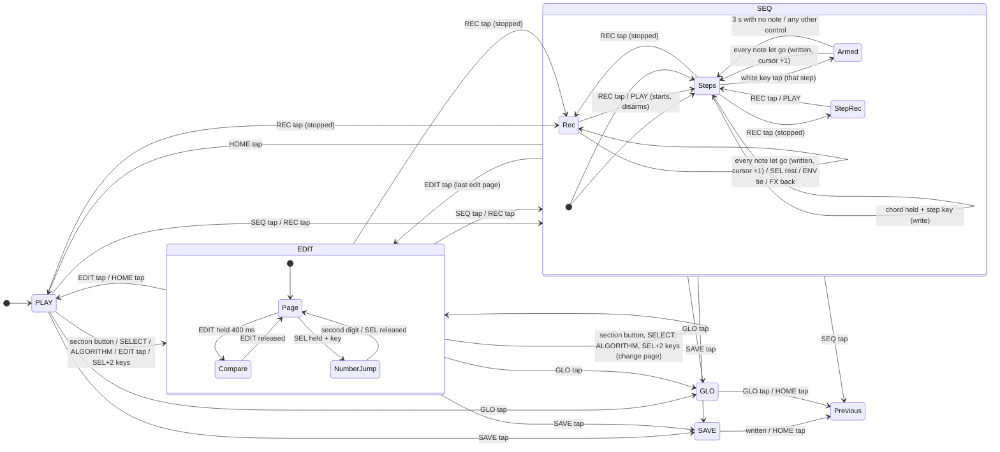

# On-device UI: interaction model

Status: proposal for #39, with Eric's decisions of 2026-11-10 applied
([section 10](#10-decisions-eric-2026-11-10)).
Owner: UX lead (interaction). The UI Designer owns colors, type and mockups,
which come from the screen content lists in [section 6](#6-screen-content-requirements).

This doc says what each control does in each state, what the screen must
show, and which behaviors the tests check. It does not say how anything
looks.

## 1. The inspiration, and the rules

fm1-8p is inspired by mid-80s two-oscillator polysynths, and the JX-8P in
particular. That synth had no knob per parameter. You called a parameter by
its number, name and value showed on the display, and one
data-entry control changed it. An optional programmer gave each parameter its
own control. Parameters were grouped by section: the two oscillators, the
mixer, the filter, the amp, two envelopes, the LFO and the chorus.

fm1-8p keeps that feel:

- **Every patch parameter has a two-digit number.** The tens digit is the
  section (1..8) and the units digit is the parameter (1..8). The numbers are
  fm1-8p's own.
- **A page is four parameters on KNOB1-4,** like a strip of a hardware
  programmer. Each section has one or two pages: units 1-4 are page A and
  units 5-8 are page B.
- **The last parameter you touched is the "focus".** The screen shows it
  large: its number, name and value. This is the one-parameter display from
  the original, and the other three knobs on the page are always live.
- **There are three ways to get to a section quickly:** a section button, the
  ALGORITHM encoder (one section per detent), or typing the number on the keys.

Rules for everything on the device: no Roland logos or panel artwork, and no
Roland product name. The one exception is the patches: the JX-8P's 32 factory
tones ship with their factory names (Eric's decision in #75; see
[docs/patches.md](../patches.md)). On the device
the sections are called DCO-1, DCO-2, MIX, VCF, VCF ENV, VCA, LFO and CTRL.
Those are generic synth terms. Chorus modes are named SLOW, DEEP and FAST,
not numbered the way the original's were.

## 2. The hardware this uses

From fm1-dock `hb_module.h` (ABI 2). fm1-8p registers with
`HB_F_SCREEN | HB_F_PANEL`:

- **`HB_F_SCREEN`:** the whole 240 x 240 screen is fm1-8p's.
- **`HB_F_PANEL`:** the keys arrive as events, so the sequencer can use them,
  and so do OCT- and OCT+. fm1-8p gives OCT- and OCT+ their usual meaning
  (octave down or up, reported to the host with `key_base`).
- **HOME:** a short press is fm1-8p's (back to PLAY). Holding it for 1.5 s
  still opens the host's module picker, and fm1-8p gets the release first.

| Control | Kind | Notes |
| --- | --- | --- |
| FX, SEL, ENV, LFO, EDIT, GLO, SAVE, ARP, SEQ, PLAY, REC | buttons | each has an LED: 0 off, 1 lit, 2 glow (dim) |
| SELECT, ALGORITHM, KNOB1-4, PRESETS | endless encoders | relative clicks, + is clockwise; \|clicks\| >= 3 in one event is a fast turn |
| 27 keys, F3..G5 (key 0..26) | keys | velocity where force is sensed (else 0), aftertouch, one LED each |
| OCT-, OCT+ | buttons | octave, -3..+3 |
| HOME | button | tap: PLAY state; hold 1.5 s: host picker |

The FM-1 has **no bend or mod wheel**. Live bend and mod come only from
MIDI in (pitch bend and CC1). On the panel, they are set per step in the
sequencer.

ARP is **not assigned** in this version. It is kept for the arpeggiator
issue, and its LED stays off.

## 3. Parameter map

The map mirrors the JX-8P's panel (as PG-8X 2.0.13 draws it), section by
section, with the **JX-8P's own parameter numbers**: the PG-800 numbers in
[docs/patches.md](../patches.md), from F. Vecoven's JX-8P manual. The PG-8X
manual gives no numbers. The tens digit is the section and the units digit the
parameter. The number shows in the LED window and in each knob column.

- **Ours:** a parameter the JX-8P doesn't have as a tone parameter (fm1-8p's
  own, or a JX-8P performance control with no PG-800 number) takes a free
  number in its section, marked *ours*.
- **Pending:** the parameter waits for an open issue. Its number and knob are
  kept, it shows `--`, and its knob does nothing until it lands.
- **Reserved:** an empty slot. It shows nothing and its knob does nothing.
- **Pages:** a section has page A (its x1-x4) and, if it has more, page B
  (x5-x8). KNOB1-4 are the page's four slots, left to right.
- **Two engine parameters on one knob:** the JX-8P's CROSS MOD and its three
  ENV MODE switches each set two engine parameters, as `tools/jx8p.py` maps them.
  The knob turns through the JX positions and sets both.

Each row gives the number, the knob, the engine parameter(s), the label (at
most 7 characters), the value as shown, and the step and fast step per click. A
fast step applies when one event carries 3 or more clicks.

### 1x DCO-1 (pages 1A, 1B)

| No. | Knob | Engine parameter | Label | Shown as | Step / fast |
| --- | --- | --- | --- | --- | --- |
| 11 | K1 | `osc1_octave` | RANGE | 16', 8', 4', 2' (and our 32') | 1 / 1 |
| 12 | K2 | `osc1_wave` | WAVE | SAW, PULSE, SQUARE, NOISE (panel order) | 1 / 1 |
| 13 | K3 | `osc1_coarse_semis` (#108) | TUNE | -12..+12 st | 1 / 1 |
| 14 | K4 | `lfo_pitch_cents` | LFO | 0..1200 ct | 1 to 99 ct: 1 / 10; then 10 / 50 |
| 15 | K1 | `pitch_env_osc1_cents` (its size) | ENV | 0..32 st, to 0.1 (32 MODE has the sign) | 10 ct / 100 ct |
| 16 | K2 | `osc1_fine_cents` (*ours*) | FINE | -100..+100 ct | 1 / 10 |
| 17 | K3 | `osc1_pulse_width_pct` (*ours*) | WIDTH | 1..99 % (inactive unless WAVE is PULSE) | 1 / 5 |
| 18 | K4 | reserved | | | |

### 2x DCO-2 (pages 2A, 2B)

| No. | Knob | Engine parameter | Label | Shown as | Step / fast |
| --- | --- | --- | --- | --- | --- |
| 21 | K1 | `osc2_octave` | RANGE | as 11 | 1 / 1 |
| 22 | K2 | `osc2_wave` | WAVE | as 12 | 1 / 1 |
| 23 | K3 | `osc_sync` + `osc_ring` | X-MOD | OFF, SYNC 1, SYNC 2, X-MOD (the JX's CROSS MOD) | 1 / 1 |
| 24 | K4 | `osc2_coarse_semis` | TUNE | -12..+12 st | 1 / 1 |
| 25 | K1 | `osc2_fine_cents` | FINE | -100..+100 ct | 1 / 10 |
| 26 | K2 | `lfo_pitch_osc2_cents` | LFO | `D1` (follows 14), 0..1200 ct | as 14 |
| 27 | K3 | `pitch_env_osc2_cents` | ENV | as 15 | as 15 |
| 28 | K4 | `osc2_pulse_width_pct` (*ours*) | WIDTH | as 17 | 1 / 5 |

### 3x DCO ENV (page 3A)

The DCO envelope's DYNAMICS and MODE, under DCO-1 on the panel. They apply to
both 15 and 27.

| No. | Knob | Engine parameter | Label | Shown as | Step / fast |
| --- | --- | --- | --- | --- | --- |
| 31 | K1 | `pitch_env_dyna` | DYNA | OFF, 1, 2, 3 | 1 / 1 |
| 32 | K2 | `pitch_env_source` + the sign of 15 and 27 | MODE | ENV2 INV, ENV2, ENV1 INV, ENV1 | 1 / 1 |
| 33 | K3 | `osc_xmod_permille` (*ours*) | XM AMT | 0..100 % | 1 / 5 |
| 34 | K4 | reserved | | | |

### 4x MIXER (pages 4A, 4B)

| No. | Knob | Engine parameter | Label | Shown as | Step / fast |
| --- | --- | --- | --- | --- | --- |
| 41 | K1 | `osc1_level_permille` | DCO-1 | 0..100 | 1 / 5 |
| 42 | K2 | `osc2_level_permille` | DCO-2 | 0..100 | 1 / 5 |
| 43 | K3 | `osc_mix_env_permille` (its size) | ENV | 0..100 | 1 / 5 |
| 44 | K4 | `osc_mix_env_dyna` | DYNA | OFF, 1, 2, 3 | 1 / 1 |
| 45 | K1 | `osc_mix_env_source` + the sign of 43 | MODE | as 32 | 1 / 1 |
| 46-48 | K2-K4 | reserved | | | |

### 5x VCF (pages 5A, 5B)

| No. | Knob | Engine parameter | Label | Shown as | Step / fast |
| --- | --- | --- | --- | --- | --- |
| 51 | K1 | `highpass_step` | HPF | BOOST, FLAT, 240 Hz, 560 Hz (JX order, #138) | 1 / 1 |
| 52 | K2 | `filter_cutoff_cents` | CUTOFF | Hz, 3 significant digits; `OPEN` at 14400 | 100 ct / 400 ct |
| 53 | K3 | `filter_resonance_permille` | RES | 0..100 (100 self-oscillates) | 1 / 5 |
| 54 | K4 | LFO to cutoff (pending, #172) | LFO | -- | - |
| 55 | K1 | `filter_env_amount_cents` (its size) | ENV | 0..164 st | 1 st / 6 st |
| 56 | K2 | `filter_key_track_permille` | KEY | 0..130 % | 1 / 10 |
| 57 | K3 | `filter_env_dyna` | DYNA | OFF, 1, 2, 3 | 1 / 1 |
| 58 | K4 | `filter_env_source` + the sign of 55 | MODE | as 32 | 1 / 1 |

### 6x VCA and CHORUS (pages 6A, 6B)

The JX-8P numbers CHORUS 64, with the VCA, so it shares the VCA's page.

| No. | Knob | Engine parameter | Label | Shown as | Step / fast |
| --- | --- | --- | --- | --- | --- |
| 61 | K1 | `amp_level_permille` | LEVEL | 0..100 | 1 / 5 |
| 62 | K2 | `amp_gate` | MODE | ENV2, GATE | 1 / 1 |
| 63 | K3 | `amp_dyna` | DYNA | OFF, 1, 2, 3 | 1 / 1 |
| 64 | K4 | `chorus_mode` | CHORUS | OFF, I, II (and our FAST) | 1 / 1 |
| 65 | K1 | `amp_velocity_pct` (*ours*: the curve while DYNA is OFF) | VEL | 0..100 % (inactive unless DYNA is OFF) | 1 / 5 |
| 66-68 | K2-K4 | reserved | | | |

### 7x LFO (page 7A)

| No. | Knob | Engine parameter | Label | Shown as | Step / fast |
| --- | --- | --- | --- | --- | --- |
| 71 | K1 | `lfo_wave` | WAVE | RANDOM, SQUARE, TRI (panel order), and our SAW | 1 / 1 |
| 72 | K2 | `lfo_delay_ms` | DELAY | time, 0..5.00 s | time table |
| 73 | K3 | `lfo_rate_centihz` | RATE | 0.01..30.0 Hz, 3 significant digits | rate table |
| 74 | K4 | `lfo_pw_pct` (*ours*) | PW | 0..49 % | 1 / 5 |

### 8x ENV-1 (pages 8A, 8B)

ENV-1 is the engine's filter envelope.

| No. | Knob | Engine parameter | Label | Shown as | Step / fast |
| --- | --- | --- | --- | --- | --- |
| 81 | K1 | `filter_env_attack_ms` | ATTACK | time | time table |
| 82 | K2 | `filter_env_decay_ms` | DECAY | time (a time constant) | time table |
| 83 | K3 | `filter_env_sustain_permille` | SUSTAIN | 0..100 | 1 / 5 |
| 84 | K4 | `filter_env_release_ms` | RELEASE | time (a time constant) | time table |
| 85 | K1 | `filter_env_key_follow_permille` | KEY | OFF, 1, 2, 3 | 1 / 1 |
| 86-88 | K2-K4 | reserved | | | |

### 9x ENV-2 (pages 9A, 9B)

ENV-2 is the engine's amp envelope (with 62 MODE at GATE, it still runs for the
cutoff, pitch and mix, #63).

| No. | Knob | Engine parameter | Label | Shown as | Step / fast |
| --- | --- | --- | --- | --- | --- |
| 91-94 | K1-K4 | `amp_attack_ms`, `amp_decay_ms`, `amp_sustain_permille`, `amp_release_ms` | ATTACK, DECAY, SUSTAIN, RELEASE | as 81-84 | as 81-84 |
| 95 | K1 | `amp_key_follow_permille` | KEY | OFF, 1, 2, 3 | 1 / 1 |
| 96-98 | K2-K4 | reserved | | | |

### 0x AFTERTOUCH and CONTROL (pages 0A, 0B)

None of these has a PG-800 number: on the JX-8P, aftertouch, bend and
portamento aren't tone parameters. Section 0 holds them, and our own voice
settings.

| No. | Knob | Engine parameter | Label | Shown as | Step / fast |
| --- | --- | --- | --- | --- | --- |
| 01 | K1 | `at_vib_cents` (#61) | AT VIB | 0..540 ct | 1 / 10 |
| 02 | K2 | `at_bri_cents` (#61) | AT BRI | 0..2360 ct | 10 / 100 |
| 03 | K3 | `at_vol_pct` (#61) | AT VOL | 0..100 % | 1 / 5 |
| 04 | K4 | `setting_glide` (*ours*, Eric's Q4) | GLIDE | OFF, ON | 1 / 1 |
| 05 | K1 | `bend_range_semitones` | BEND | 0..24 st | 1 / 2 |
| 06 | K2 | `portamento_ms` (#62: tau, 0 off) | PORTA | time, OFF at 0 | time table |
| 07 | K3 | `voice_mode` (*ours*) | VOICE | POLY, UNISON | 1 / 1 |
| 08 | K4 | `unison_detune_cents` (*ours*) | DETUNE | 0..100 ct (inactive in POLY) | 1 / 10 |

### 0C WHEEL (page 0C)

The mod wheel's amounts (#41), on a third page of section 0 (Eric: 0B had no free knob). They have no
PG-800 number and no CC, so they show as W1 and W2; the number jump's two digits can't reach them,
but LFO's ring and SELECT do. The LED window shows only the digit (a 7-segment W can't be drawn).

| No. | Knob | Engine parameter | Label | Shown as | Step / fast |
| --- | --- | --- | --- | --- | --- |
| W1 | K1 | `wheel_pitch_cents`: the wheel at full adds this to the vibrato depth | PITCH | 0..1200 ct | 1 / 10 |
| W2 | K2 | `wheel_pw_pct`: the wheel at full adds this to the PW depth | PW | 0..49 % | 1 / 5 |

### Units and value tables

- **Time:** the engine stores ms. The screen shows `0 ms` .. `999 ms`, then
  `1.00 s` .. `9.99 s`, then `10.0 s` .. `32.0 s`. A knob click moves one entry in a
  fixed table of about 115 entries from 0 to the parameter's maximum (32000 ms
  for every envelope time, as a JX-8P ATTACK runs to about 34 s, as long as the patch
  table's int16 holds), spaced about
  7 % apart above 20 ms: 0, 1, 2, 3, 4, 5, 6, 8, 10, 12, 15, 18, 20, 22 ... 32000. A fast
  turn moves 4 entries. A value that is not in the table, from MIDI or an
  older patch, snaps to the nearest entry on the first click, in the direction
  of the turn.
- **DECAY and RELEASE times are time constants** (#99): the decay and release are
  exponential, as on PG-8X, and the screen shows their tau, the time the
  distance to the target takes to fall to 37 % (-8.7 dB). The level is down
  20 dB at 2.3 x the shown time and 40 dB at 4.6 x. A release ends (the voice
  is free) at -80 dB, 9.2 x the shown time. ATTACK stays the time to the peak.
  This changed what a stored DECAY or RELEASE means: a patch saved before it
  plays its decay and release slower and longer (fine before release; no
  patches have shipped).
- **LFO rate:** the same idea, a table from 0.01 Hz to 30.0 Hz, about 6 %
  apart.
- **Cutoff:** shown as Hz from `8.18 * 2^(cents/1200)`, three significant
  digits (`440 Hz`, `1.25 kHz`, `12.0 kHz`). At the top of the range, 14400 ct
  (`FM_FILTER_OPEN_CENTS`, the maximum of `filter_cutoff_cents` in
  `engine/params.c` on main), it shows `OPEN`.
- **The engine's value is the truth.** Values between steps, which only MIDI
  or an older patch can set, show as their nearest rounded value. Nothing
  rewrites them until a knob turns them.
- **Fast turns:** a fast step applies when one event has \|clicks\| >= 3. Each
  click then moves by the fast step. Smaller events move by the normal step
  per click.
- **Clamping:** at the end of a range the value stays put. Encoders never wrap
  a parameter's value. They do wrap pages and sections.

### Page order

The SELECT encoder walks the pages in number order, section 1 to 9 then 0, and
wraps at both ends:

`1A, 1B, 2A, 2B, 3A, 4A, 4B, 5A, 5B, 6A, 6B, 7A, 8A, 8B, 9A, 9B, 0A, 0B, 0C` (19 pages)

**Pages with nothing live are skipped.** The SELECT walk and the section
button rings skip a page whose slots are all pending or reserved, and the page
joins them once one of its slots is live. A number jump to a slot on a skipped
page still shows that page, and the screen's page position still counts all 18.

ALGORITHM jumps by section (1..9, 0, wrapping) to the section's page A.

## 4. Buttons and encoders

### Section buttons (in PLAY and EDIT)

Each section button owns a ring of pages. Its **first press** goes to the
ring's first page. Pressing it **again while on its ring** goes to the next
page in the ring, and wraps. The button's LED is lit while one of its pages
is shown, and glows otherwise.

| Button | Ring | Why |
| --- | --- | --- |
| SEL | 1A, 1B DCO-1; 2A, 2B DCO-2; 3A DCO ENV; 4A, 4B MIXER | the sources: "select the source" |
| ENV | 5A, 5B VCF; 8A, 8B ENV-1; 9A, 9B ENV-2 | the filter, with the envelopes |
| FX | 6A, 6B VCA and CHORUS | the output end |
| LFO | 7A LFO; 0A, 0B AFTERTOUCH and CONTROL; 0C WHEEL | modulation and performance |

The FM-1 has four section buttons for the panel's ten sections, so each
button holds the sections that sit together on the panel. VCF is the
most-edited section, so it comes first on ENV, and the PLAY screen's knobs are
a VCF shortcut too (see [PLAY](#play-the-home-state)).

### Number jump (the original's "call a parameter by number")

In PLAY or EDIT:

1. Hold SEL and tap two white keys.
2. The ten white keys from F3 to A4 (F3, G3, A3, B3, C4, D4, E4, F4, G4, A4)
   are the digits 1..9 and 0. While SEL is held, keys make no sound, and those
   ten key LEDs glow as a keypad. (Sections run 1..9 and 0, so the keypad needs
   all ten.)
3. After the second digit, fm1-8p goes to that parameter's page and makes it
   the focus.
4. A number with no parameter (a reserved slot) goes to its page, the focus is
   empty, and the screen shows `NO PARAMETER`.
5. Releasing SEL after one digit goes to that section's page A.
6. A SEL tap, pressed and released in under 400 ms with no key in between, is
   the ring step from the table above. It acts on release.

### EDIT: edit page and compare

- **EDIT tap** (under 400 ms):
  - in PLAY: goes to the last edit page shown (5A the first time);
  - in EDIT: goes back to PLAY;
  - in SEQ: goes to the last edit page while the sequencer keeps running.
- **EDIT hold** (400 ms or more), in PLAY or EDIT: **compare**.
  - While it is held, the stored patch sounds and the screen shows its values.
  - Knobs are ignored, and a turn shows `COMPARE: RELEASE EDIT` (it fits the 240 px footer).
  - Releasing EDIT puts the edit buffer back, exactly as it was.
  - With no edits, a hold shows `NO EDITS` and changes nothing.
- **EDIT LED:** lit while the edit buffer differs from the stored patch. It
  blinks during compare, and glows when there are no edits.

### PRESETS: patch browsing

- **In PLAY and EDIT:** each click loads the next or previous patch at once
  (a fast turn moves 8: with every slot full, a row, 11 to 21). Numbers wrap, and
  empty user slots are skipped. The page you are on stays, so you
  can compare a section across patches.
- **Unsaved edits:** when the edit buffer is modified, the first PRESETS
  **event** does not load anything, whatever its click count (a fast +8 warns
  just like +1). It shows `EDITED - TURN TO DISCARD`.
  - A **later** event in the same direction while the warning shows (1.5 s)
    discards the edits and loads, moving by that event's clicks.
  - Anything else cancels the warning (decision Q4).
- **The edit buffer survives power-off** (decision Q4). It is kept with the
  module's settings, in the settings record if it fits in 240 bytes and in a
  flash bank otherwise. Flash wears out, so it is written only:
  - when the module is released; or
  - once the buffer has gone 10 s with no change since the last edit.

  It is never written while any voice sounds or the sequencer plays; a write
  that is due then waits for silence. The same rule covers the pattern edit
  buffer.
- **In SAVE:** PRESETS picks the destination slot.
- **In GLO:** PRESETS browses patches as in PLAY.
- **In SEQ view:** PRESETS browses **patterns**, not patches. See
  [Pattern slots](#pattern-slots).

### Patch numbering

- **User patches:** 64 slots numbered 11..88, two digits 1..8 each, like the
  parameter numbers (11..18, 21..28, ... 81..88).
- **Starter patches (#14):** a separate read-only group, shown with a `P`
  prefix (`P1`, `P2`, ...). PRESETS goes through the user slots 11..88, then
  the P group, then wraps.
- A starter patch can be edited and saved to a user slot. SAVE never offers a P
  slot as the destination.
- **Program change mapping**, the same for receive and send (G41):
  - PC 0..63 map to slots 11..88 in order: PC 0 = 11, PC 1 = 12 ... PC 7 = 18,
    PC 8 = 21 ... PC 63 = 88. In other words, slot = 11 + 10 x (PC / 8) +
    (PC mod 8).
  - PC 64 and up are the P group: PC 64 = P1, PC 65 = P2, and so on.
  - A received PC past the last P patch is ignored.
  - With SEND or BOTH, loading a patch on the panel sends its PC by the same
    mapping.
  - Patterns have no program change.

### SAVE

SAVE saves the **patch** from PLAY and EDIT, and the **pattern** from SEQ
view. The flow is the same for both; only the slots differ.

1. **SAVE tap** in PLAY or EDIT opens SAVE for the patch. In SEQ view it opens
   SAVE for the pattern.
   - The destination starts at the current slot.
   - The name is the current one.
2. **In SAVE:**
   - PRESETS: the destination slot (patch 11..88, or pattern 11..88). It
     shows the name of what is there now, or `EMPTY`. A fast turn moves 8, a
     row of slots (11 to 21).
   - ALGORITHM: the next empty slot (counterclockwise: the previous), one
     empty slot a click, wrapping. With every slot used it stays.
   - KNOB2: moves the name cursor. SELECT moves it too.
   - KNOB1: the character at the cursor (A-Z, 0-9, space, `-`).
   - KNOB3: inserts or deletes at the cursor, one character a click (a fast
     turn too). Clockwise inserts a space, and counterclockwise deletes.
   - PLAY, OCT-, OCT+ and the keys work as usual, so the sound can be played
     while naming it. Their LEDs follow their usual rules.
   - Every other button does nothing in SAVE, and its LED is off.
3. **SAVE tap again** writes the patch. If the destination holds another
   patch, the first tap shows `REPLACE 23 <NAME>?`, `SAVE AGAIN TO REPLACE`,
   `HOME CANCELS` and `PRESETS: OTHER SLOT`, and the second tap writes.
   - **The screen:** `TO 23` with what is there now (or `EMPTY`) at the right,
     and `+ EDITS` after the number when the edit buffer is edited, so a
     rename shows it also saves the sound's edits. The name shows as 12 fixed
     cells, an empty one as a dim dot, with the cursor under its cell (a blank
     one too).
4. **After the write:** it shows `SAVED 23` (or `SAVED PATTERN 23`) for 1.5 s,
   that edit buffer becomes clean, and the state goes back to where SAVE was
   pressed.
5. **Cancel:** HOME tap (EDIT does nothing in SAVE). Nothing is written, and
   it shows `SAVE CANCELED`.
   - The name as edited is kept as a draft, in RAM only. The next SAVE of the
     same patch starts with it instead of the patch's name. There is one
     draft: the last canceled one. A write clears it.
6. **A write erases a flash bank,** which stalls the sound for about 100 ms.
   - **Waiting:** if any voice is sounding or the sequencer is playing, the
     write waits.
     - A **snapshot** of the patch (or pattern), its name and its destination
       is taken at the confirming tap.
     - The state goes back to where SAVE was pressed, and every screen shows
       `SAVING 23 WHEN SILENT` until the write happens, every other 1.5 s
       `HOLD SAVE: NOW` (how to force it).
     - The snapshot is written on the first silent moment. Edits, a program
       change or a patch or pattern change while waiting do not change what is
       written.
   - **Force:** holding SAVE for 1 s or more while `SAVING 23 WHEN SILENT` shows
     writes the snapshot at once, accepting the dropout (decision Q5). A SAVE
     tap then does nothing; it does not open a second SAVE.
   - **Cancel:** the first HOME tap while a write is waiting asks:
     `HOME AGAIN TO CANCEL SAVE`. A second HOME tap within 1.5 s cancels it,
     showing `SAVE CANCELED`. Neither tap does anything else (no going home).
   - **After the write:** the edit buffer is clean only if it still equals the
     snapshot. Otherwise EDITED stays.
   - A failed write shows `SAVE FAILED` and keeps the edit buffer dirty.

7. **Delete (#303):** SEL held 1.5 s (on its release, as SEQ view's clear) on
   a destination that holds a patch (or pattern) asks `DELETE 23 <NAME>?`,
   `SEL AGAIN TO DELETE` and `HOME CANCELS` (30 characters at most: SEQ's SAVE
   screen already says it is a pattern). On an
   `EMPTY` slot, and on a short tap, SEL does nothing. P slots can't be
   reached (PRESETS walks the user slots).
   - **A second SEL tap** deletes it. Silent, at once: `DELETED 23` (or
     `DELETED PATTERN 23`) shows for 1.5 s, and SAVE stays open on the slot,
     now `EMPTY`. Otherwise it waits as a write does: `DELETING 23 WHEN
     SILENT`, back where SAVE was pressed, SAVE held forces it, HOME twice
     cancels it. A pattern that is playing plays on until then.
   - A waiting delete has its own cancel words: `HOME AGAIN TO CANCEL DELETE`,
     then `DELETE CANCELED`. `HOLD SAVE: NOW` stays (SAVE held forces it). SEL's
     LED stays off in SAVE (the delete starts with a hold).
   - **HOME** cancels the question only (SAVE stays open), and turning PRESETS
     to another slot does too. A SAVE tap while it shows asks `REPLACE` as on
     any slot that holds one.
   - The slot is then empty, in flash too (a power cycle keeps it so): PRESETS
     skips it, ALGORITHM finds it, a program change to it is ignored.
     Deleting the slot that is loaded leaves what plays as it is, shown
     edited (for a pattern: edited against the empty pattern the slot now
     loads). Deleting the queued pattern's slot cancels the queue (see
     [Running, queued and stored patterns](#running-queued-and-stored-patterns)).
     A failed delete shows `DELETE FAILED`.

A patch never includes a pattern, and a pattern never includes a sound
(decision Q2).

### GLO: global settings

GLO holds settings for the instrument, not for a patch. They are kept in the
module's settings record, and saved 2 s after the last change once nothing
is sounding, as fm1-dock's rules ask.

- GLO tap opens GLO. GLO tap or HOME tap goes back to the previous state.
- SELECT and ALGORITHM move between the GLO pages, and KNOB1-4 edit them.
- Numbers have a `G` prefix so they are never confused with patch
  parameters.

| No. | Knob | Setting | Shown as | Default |
| --- | --- | --- | --- | --- |
| G11 | K1 | MIDI channel in | 1..16, ALL | ALL |
| G12 | K2 | MIDI channel out | 1..16 | 1 |
| G13 | K3 | Clock source | AUTO, INT, MIDI | AUTO |
| G14 | K4 | Clock out | OFF, ON | OFF |
| G21 | K1 | CC receive | OFF, ON | ON |
| G22 | K2 | CC send (knob moves go out as CC) | OFF, ON | OFF |
| G23 | K3 | CC map (see [the CC map](#the-cc-map)) | JX, STANDARD | STANDARD |
| G24 | K4 | External CC response | JUMP, PICKUP | JUMP (decision Q6) |
| G31 | K1 | Velocity curve (the host's `sense_set` curve) | 50..200 % | 100 % (the host's own) |
| G32 | K2 | Fixed velocity, for keys with no force sensing | 1..127 | 100 |
| G33 | K3 | Key LEDs follow played notes | OFF, ON | ON |
| G34 | K4 | Theme | MEMBRANE, NIGHT PANEL | MEMBRANE |
| G41 | K1 | Program change | OFF, RECV, SEND, BOTH | RECV |

**MIDI channels (G11, G12):** G11 takes the channel messages of one channel (notes, CCs, bend,
pressure), or every channel with ALL. System messages (clock, start, stop) always come in. G12 is
the channel the panel sends on: its keys' notes, and CCs with G22. A key's note-off goes on the
channel its note-on went on, even if G12 changed while it was held. The host has its own MIDI CH
option, which passes only that channel on, as channel 1 (fm1-dock `dock.c`, "MIDI CH"). With it
set, leave G11 at ALL (or 1).

**Velocity curve (G31):** force-sensed keys' velocity is the host's: 1 + 126 (1 - t)^curve, t the
press's force (fm1-dock `sense.c`). G31 sets that curve as a % of the host's own exponent, 0.70: 100 %
(the default) is the host's, 50 % (0.35) gives higher velocities for the same press, 200 % (1.40)
lower ones. The module sends it with fm1-dock's `sense_set`, its other settings at the host's own
defaults: on, DRIVE 2, ceiling 1000 (`dock.c` `sense_defaults`, "CS-1's defaults at DRIVE 2; a module
may set its own while it runs"). The host has no user setting for DRIVE or the ceiling and starts
every module at those defaults, so G31 changes only the curve. A host before `sense_set` ignores G31.
Keys with no force sensing play at G32.
**Key LEDs (G33):** ON lights a panel key's LED while it is held, OFF leaves it dark. The number
jump's keypad glow (SEL held) shows either way, and so will the sequencer's step keys in SEQ view.

Program change is G41, on a fourth page (Eric: CC MAP took G23). G42-G44 are empty for now.

G13 CLOCK SOURCE (#38) and G14 CLOCK OUT (#286) are live. G21-G24 are live (#49).

**Clock out (G14, #286):** with it on, the sequencer sends MIDI clock, start
and stop, only while it plays (Eric, 2026-11-18). A G14 change takes effect
at the next PLAY.

- **On its own clock:** MIDI start, then 24 clocks a quarter note at its
  tempo, a clock on every step's start (6 a step; swing doesn't bend the
  clock), then MIDI stop. A restart from step 1 sends a stop, then a start.
- **Following an incoming clock (G13):** it passes the clock on: each clock
  that comes in goes out once, as it came, and none of its own. The start
  (or continue) goes out as the sequencer starts on it, and the stop as it
  stops (a stop that comes in, or the clock lost). A hand-over from its own
  clock to an incoming one sends its stop, then the start.
- **Timing:** fm1-dock sends MIDI from its main loop only, so a clock goes
  out at the next main loop pass (its longest part, one draw call, measured
  2.3 ms in fm1-emu). Clocks are never lost: late ones go out together.
- **Watch for loops:** if the device sending the FM-1 its clock also takes the
  FM-1's MIDI out back in (a DAW echoing its MIDI input to its output), the
  clock goes round. Turn G14 off, or don't route the FM-1's out back to it.

**CC send (G22):** with it ON, a panel knob turn goes out as its parameter's CC (the CC map below),
on G12's channel, on the scale a CC in reads, so a DAW that records it and plays it back lands on
the same knob position. A CC that came in never goes back out. At most one CC goes out every 10 ms,
each parameter's latest value when it goes, and the same CC and value isn't sent twice in a row, so
a fast turn can't flood MIDI out.

**Theme (G34):** the screen's look for the whole instrument, not per patch.
It takes effect at once, redrawing the whole screen, and is saved with the
other GLO settings. The UI Designer owns what each theme looks like. The
interaction model is the same in both.

**Clock source:**

- **AUTO:** follows MIDI clock when it arrives, and goes back to the internal
  clock after it stops (#38). A clock is gone after 250 ms with no tick (or 3
  ticks' time, if that is longer). If it was running the sequencer, the
  sequencer stops as it does on MIDI stop, and the next PLAY runs on the
  internal clock (Eric).
- **INT:** ignores MIDI clock.
- **MIDI:** only MIDI clock. With no clock coming in, the sequencer waits. A
  clock lost while playing stops it, as in AUTO. With no clock there (none
  yet, or lost), SEQ view says `MIDI NO CLOCK` and shows `--` for the tempo.
- **Clock edges (#38):**
  - PLAY armed in AUTO for the clock's next tick, and the clock lost first:
    disarmed, as a stop. Under MIDI, PLAY stays armed and waits.
  - G13 changed while PLAY waits: to AUTO, it starts on the next tick (or
    plays its own with no clock coming); to MIDI, it waits for a start.
  - A start or continue with no tick yet shows `WAITING FOR CLOCK` until the
    first tick. In AUTO, one with no clock after it for the gone time (250 ms)
    is dropped.
  - The tempo shown is the clock's whole BPM, held against jitter: it moves
    when the clock is 0.75 BPM off it, up or down.
  - A clock that starts slower than 10 BPM (over 250 ms a tick) never counts
    as a clock: it is gone before its second tick measures it. Once one is
    measured, it is gone only after three of its ticks' time, so a clock
    locked faster may slow below 10 BPM and stay.
  - While AUTO plays its own clock, a clock coming in with no start doesn't
    take over: the screen keeps INT and the pattern's tempo, and TEMPO turns.
  - G13 MIDI, waiting on a bare MIDI start (no clock yet): PLAY arms and a
    second PLAY cancels, as when waiting for a start (Eric, 2026-11-18). In
    AUTO, PLAY then plays its own clock.
- **Under MIDI clock** (#38): 24 ticks a quarter note, 6 a step. MIDI start
  plays from step 1 and continue from the step after the last one played,
  each on the next tick. MIDI stop lets every note go. The steps start on
  exact samples at the clock's measured tempo, locked to its ticks: within
  0.5 ms of them with +-1.5 ms of jitter, once locked. SWING and GATE are
  of the clock's step. Ticks held up and then delivered all at once (a USB
  stall) are taken where they were due. Over USB only for now: fm1-dock
  doesn't yet pass real-time messages from the DIN jack (fm1-dock#91).

### Transport and sequencer buttons

PLAY, SEQ and REC are described in [section 5](#5-sequencer).

OCT- and OCT+ shift the keys by an octave, in every state. That includes REC
step entry, where the octave sets the pitch that is written.

### Encoders summary

| Encoder | PLAY | EDIT | SEQ | SAVE | GLO |
| --- | --- | --- | --- | --- | --- |
| SELECT | page (goes to EDIT) | page | step cursor | name cursor | GLO page |
| ALGORITHM | section (goes to EDIT) | section | SEQ page | next empty slot | GLO page |
| KNOB1-4 | performance knobs | page's parameters | SEQ page's values | K1 char, K2 cursor, K3 insert/delete | settings |
| PRESETS | patch | patch | pattern | destination slot | patch |

## 5. Sequencer

This follows #35-#42: 16 steps, and each step holds a note, a chord (up to the
voice count), a tie or a rest. Each step also has a velocity, a bend and mod
value, and a jump or glide move.

### The keyboard in SEQ view (Eric, 2026-11-15, over decision Q1)

**Outside SEQ view, all 27 keys play notes.** In SEQ view:

| Keys | In SEQ view |
| --- | --- |
| the 16 white keys, F3..G5 | **step keys**: F3 is step 1, G3 step 2 ... G5 step 16. They make no sound. |
| the 11 black keys | **nothing**: silent, LEDs dark. |

- **Tap a step, then play** (see [Writing steps](#writing-steps)): a step key
  arms that step, and then all 27 keys play notes until the step is written.
- **The octave applies** to the notes played: OCT- and OCT+ shift them as
  usual, so any register is reachable.
- **MIDI notes in** play and write the same way as the keys.
- **Every key remembers how it started.** A key held when SEQ view opens or
  closes still releases the way it began (see
  [Keys that change meaning while held](#keys-that-change-meaning-while-held)).

### Key LEDs

The white keys in SEQ view, while no step is armed (steps 1-16):

| Step | LED |
| --- | --- |
| past the pattern length | off |
| rest or empty, within the length | glow |
| note or chord | lit |
| tie | lit, with a short off blink every 500 ms |
| cursor (stopped) | blinks between lit and glow at 4 Hz; 8 Hz while armed or in REC (Eric, 2026-11-15) |
| playhead (playing) | the step's state inverted for the step's length: lit becomes off, glow or off becomes lit |

The black keys in SEQ view are dark. While a step is armed, any key held is
lit.

In REC (step record, S5): every key plays, so a key held is lit; the cursor
step's white key blinks at 8 Hz (where the next step lands), and the other
white keys keep showing their steps, dimmed, as a map (Eric, R2).

Outside SEQ view:

- **While the sequencer plays:** only the playhead step's white key is lit.
  Held notes are also lit if G33 is on.
- **When stopped:** held notes are lit if G33 is on, and everything else is
  off.

Button LEDs:

- **SEQ:** lit in SEQ view, and glows otherwise.
- **PLAY:** lit while playing, with a short dark flash on each beat. Glows
  when stopped. Blinks when it is waiting for external clock.
- **REC:** lit while step record is armed, and glows otherwise (stopped). While
  playing it's off: REC does nothing then but say `STOP TO RECORD`.
- **FX in SEQ view:** glows in REC (BACK), off otherwise.
- **LFO in SEQ view:** glows (MOVE: JUMP or GLIDE on the cursor step, #42).

### SEQ view

The SEQ view's screen is a **piano roll**: steps across, pitch up and down. The
visual details are in PR #53. This doc gives its content (section 6) and its
controls.

SEQ tap goes to SEQ view. SEQ tap in SEQ view goes back to the state SEQ was
pressed from. In SEQ view:

- **SELECT** moves the step cursor (1..length, wraps), and the screen shows
  that step.
- **A step key** (a white key) moves the cursor to that step and arms it: the
  notes played next are written there (see [Writing steps](#writing-steps)).
  It plays nothing itself; there is no audition of the step's old notes
  (Eric, R4: the roll shows them).
- **PRESETS** browses patterns (see [Pattern slots](#pattern-slots)).
- **SAVE** saves the pattern.
- **ALGORITHM** picks the SEQ page:

| Page | K1 | K2 | K3 | K4 |
| --- | --- | --- | --- | --- |
| S1 PATTERN | TEMPO 30..300 BPM (step 1, fast 10) | LENGTH 1..16 | SWING 50..75 % | GATE 5..100 % |
| S2 STEP (the cursor's step) | VEL 1..127 | BEND -100..+100 % of the bend range (and the semitones it gives) | MOD 0..127 | MOVE JUMP, GLIDE |
| S3 PLAY | TRANSPOSE -24..+24 st | KEY TRANSPOSE OFF, ON | - | - |

- **Pattern settings are part of the pattern.** TEMPO, LENGTH, SWING and GATE
  are saved with it, and loading a pattern sets them. TRANSPOSE and KEY
  TRANSPOSE are performance settings and are not saved.
- **TEMPO under external clock:** TEMPO shows the measured tempo and
  `MIDI CLOCK`. Turning it shows `TEMPO FOLLOWS MIDI CLOCK` and changes
  nothing.
- **On a rest step,** S2 shows that step's values but marks them inactive.
  Rests and ties keep the bend and mod they had (#42). On a tie too, and
  neither the knobs nor LFO change them there. A step written again (notes
  played into it) takes the live bend and mod instead, as any written step
  does (see [Writing steps](#writing-steps)).
- **BEND's semitones:** while BEND has the focus, the readout's last line
  shows its percent and the semitones it gives at BEND RANGE now
  (`BEND +50 % = +1.0 st`). A VEL turn changes only the velocity.
- **Section buttons mean something else in SEQ view.** They are steps, not
  sections, and the screen labels them:

| Button | Not in REC | In REC (step record) |
| --- | --- | --- |
| SEL | clear the cursor step (make it a rest) | write a REST, advance |
| SEL held 1.5 s | clear the whole pattern (the saved copy stays until SAVE) | - |
| ENV | toggle TIE on the cursor step | write a TIE, advance |
| LFO | toggle JUMP or GLIDE on the cursor step | same |
| FX | unassigned | step back one step, without writing |

### The piano roll (S5, spec draft)

SEQ view's screen is visual.md's piano roll (PR #53): the layout, the grid,
how a note, chord, tie, rest, past-length step, the cursor and the playhead
look, and the per-column redraw are as visual.md has them, in step entry, in
REC and while playing. It replaces S2's 16-step strip. Eric's "I would prefer a
piano style sequencer" (2026-11-15) is this plan; the input stays as it is.

**The roll doesn't depend on REC,** so it lands first, as its own PR (S5a,
after Eric's #250 report), and REC follows (S5b).

What the white-key steps add to #53:

- **The 27-key strip** underlines the 16 white keys as the steps and the black
  keys dim (visual.md, updated).
- **The readout's last line** is `PLAY` (or `REC`) with the notes played so
  far while a step is armed or REC builds one, else `TAP STEP, THEN PLAY`
  (#53's `HELD` line).
- **The armed step** (new with tap-then-play; #53 has no armed state): its
  cursor frame thickens to 2 px and blinks, and the notes being played appear
  in its column at 45 % as they go down, in full once written (Eric, 2026-11-15,
  having seen #53's mockup: "I like it. Carry on.").

### Writing steps

There are two ways to write a step. Both write the notes played (keys or MIDI
in, with the octave applied). In both:

- **Note count:** only as many notes as the voice count are kept, the first
  ones pressed. The rest are dropped, and the screen shows `MAX n NOTES`, where
  n is the build's voice count (6 by default).
- **Velocity:** the highest velocity among the chord's notes. A key with no
  force sensing uses G32.
- **Bend and mod:** the live MIDI-in pitch bend and CC1 as the step's first
  note goes down (#42; Eric, 2026-11-18). Moving the wheels while the step is
  held changes nothing, so a bent chord keeps its bend after the pitch wheel
  springs back. With no MIDI controller, these are center and 0.

**1. Tap a step, then play (any time in SEQ view, playing or stopped; Eric):**

1. Tap a white key. The cursor moves to that step and the step is **armed**:
   its key blinks at 8 Hz, and the screen says `PLAY`.
2. Now all 27 keys play notes (the step key too, as a note), and so do MIDI
   notes in. The notes played join the step being written.
3. When every key and MIDI note is let go, the notes are written to the step,
   the cursor moves to the next step (around at the length), and the white
   keys are steps again.
4. **Nothing played:** a tapped step with no note only moves the cursor. It
   stops being armed after 3 s with no note, or at once on any other control
   (a knob, an encoder or a button), and the white keys are steps again. Once
   a note is down there is no time limit: the step is written when it's let go.
5. Tapping the armed step's key again plays its note (it isn't a way out), so
   a step can hold the note of its own key.

**2. Step record (REC, while stopped; S5, spec draft):**

Step record is way 1 kept armed: you play a line of steps one after another,
without tapping each step first.

1. **Arming:** REC tap while stopped arms step record. If you are not in SEQ
   view, it goes there. The cursor stays where it is, the REC LED is lit, and
   the header's chip reads `REC`. While playing, REC does nothing but show
   `STOP TO RECORD` (decision Q3), and its LED is off.
2. **The keyboard in REC:** all 27 keys play notes (Eric, R1); none is a step
   key. MIDI notes in play too.
3. **Building and writing a step:** each key down sounds and joins the step
   being built. When every key and MIDI note is let go, the step is written at
   the cursor (the first voice-count notes, at the highest velocity, as in
   way 1) and the cursor advances, around at the length. Recording goes on at
   the new cursor: there is no time-out in REC.
4. **Moving the cursor:** SELECT moves it, as outside REC. FX steps back one
   step without writing.
5. **Rests and ties:** SEL writes a rest and ENV writes a tie at the cursor,
   and each advances it (outside REC they act on the cursor step without
   advancing).
6. **Leaving:** REC tap disarms, as does leaving SEQ view (SEQ, HOME, EDIT or
   GLO) or opening SAVE (Eric, 2026-11-15). A step being built when REC
   disarms is dropped (nothing is written).
7. **PLAY while armed:** the sequencer starts and REC disarms, so a performance
   doesn't record over the pattern. There is no live recording while playing in
   this version (decision Q3).
8. **Bend and mod** (#42, S7): the live MIDI-in bend and CC1 as each step's
   first note goes down, as in way 1, on G11's channel (CC121 centers and
   zeroes them). The pattern's own bends while it plays don't count. A written
   step's move is JUMP.

### Pattern slots

Patterns have their own slots, separate from patches (decision Q2).

- **Numbering:** 64 user pattern slots numbered 11..88, two digits 1..8 each,
  like patches (decision Q9). The screen always says which kind: `PATCH 23`
  and `PATTERN 23` are different things.
- **Storage:** patterns are kept in their own flash banks. The format and size
  are #40's.
- **An empty slot loads as an empty pattern:** 16 rests, LENGTH 16, and the
  default TEMPO, SWING and GATE.
- **The pattern edit buffer** is the pattern being played and edited.
  - It is separate from the sound's edit buffer.
  - It has its own PATTERN EDITED marker.
  - It survives power-off the same way (decision Q4).
- **Browsing:** PRESETS in SEQ view.
  - **Stopped:** each click loads the next or previous pattern at once. With
    PATTERN EDITED, the first event warns `PTN EDITED - TURN TO DISCARD`
    (28 characters, the footer's room; Eric, 2026-11-15), and another
    the same way within 1.5 s discards and loads, as for patches. A fast turn
    moves a row (8 slots).
  - **Playing:** the pattern doesn't change mid-pass. Clicks pick the **next
    pattern**, shown as `NEXT PATTERN 23`. It takes over when the running
    pattern ends its pass (after its last step).
  - Turning back to the running pattern's number cancels the next pattern.
  - With PATTERN EDITED, the warning comes first, as when stopped.
- **Saving:** SAVE in SEQ view, the same flow as a patch (see
  [SAVE](#save)).
- **Patch and pattern never change each other.**
  - A patch change, from PRESETS or a MIDI program change, changes only the
    sound, and the running pattern plays on (decision Q8).
  - A pattern change changes only the notes.

#### Running, queued and stored patterns

Four words for what plays and what is saved (#324; Eric, 2026-11-21):

- **Running pattern:** what the sequencer plays now. Its slot and name are in
  the footer (`PTN 12 NAME`), and edits are edits of it.
- **Queued pattern:** the slot chosen, while playing, to take over at the end
  of the pass (`NEXT 23`). The queue means "slot 23 next".
- **Stored pattern:** what the running pattern's slot holds. PATTERN EDITED
  (`*`) means the running pattern differs from it.
- **Takeover:** the moment, after the running pattern's last step, when the
  queued pattern becomes the running one.

What follows from them:

| Case | What happens |
|---|---|
| A slot's pattern is saved while it is queued | The takeover plays what the slot holds now, and the screen shows the slot's new name. |
| A queued slot is deleted | The queue is canceled. The running pattern plays on and `NEXT` clears. |
| A takeover while the running pattern is edited | Its edits are dropped. Queueing it already warned. |
| Another pattern takes over while SAVE is open | SAVE saves the pattern it opened on, as it was then, into the slot and under the name it offered. The pattern that took over stays the running one, unedited (Eric, 2026-11-21). |
| A SAVE waiting for silence when another pattern takes over | The save writes the snapshot it took. The pattern that took over stays the running one, unedited. |
| The same, saved into the slot of the pattern that took over | That pattern shows edited: what plays differs from what its slot now holds. |
| The running pattern's slot is deleted | It plays on, edited against the empty slot. |

Every screen, SAVE, PRESETS turn and step edit sees a takeover as soon as it
happens, not only from the next redraw. SAVE in SEQ view always offers the
running pattern's slot, and takes the pattern, its slot and its name together
when it opens.

### Playing

- **PLAY** starts from step 1, or stops. It works in every state, including
  SAVE and GLO. It acts on **press**, not release, so it is on time.
- **Stopping:**
  - note-offs go out for everything the sequencer started;
  - bend returns to center and mod returns to the live wheel (#42);
  - a queued next pattern loads at once;
  - with G14 on, MIDI stop goes out.
- **Starting** sends MIDI start, with G14 on.
- **Clock source MIDI** (G13): a PLAY press arms the start: PLAY blinks, and
  the sequencer starts on the next MIDI start or continue. A second press
  disarms.
- **Clock source AUTO with a clock coming:** a PLAY press starts from step 1
  on the clock's next tick, locked to it, with no MIDI start needed (Eric:
  many devices send clock and never a start).
  - MIDI start, stop and continue act as #38 says, whatever the PLAY LED shows.
- **Transpose:** S3 TRANSPOSE sets an offset, -24..+24 semitones.
  - With KEY TRANSPOSE on and the sequencer playing, played keys do not sound.
    They set the transpose to the **lowest** key held minus a reference C, at
    the next step (#37). The result is clamped to -24..+24.
  - **The reference C:**
    - outside SEQ view, C4 for panel keys;
    - in SEQ view, the panel keys are steps (or armed for a step), so KEY
      TRANSPOSE takes MIDI notes only there (settled with S3's KEY TRANSPOSE);
    - for MIDI notes in, MIDI note 60 (C4), in any view.

    Panel keys use their pitch before the octave shift.
  - **Outside SEQ view** there are no step keys, so a key press transposes at
    once.
  - **In SEQ view, writing a step comes first:** the panel keys stay step
    keys and never transpose. A MIDI note transposes, unless a step is armed
    (tap, then play) or REC is: then it plays and writes that step, and the
    transpose stays as it was (#39).
  - Releasing the keys keeps the transpose.
  - When stopped, while PLAY waits for a clock, or with KEY TRANSPOSE off,
    keys play normally. A STOP press lets the keys play at once.
  - **Every key ends the way it began:** a key or MIDI note that started
    playing (stopped, say) lets its note go even if the sequencer started
    since; one taken for the transpose is taken on release too, even after
    STOP, so no note hangs and none goes off twice.
  - KEY TRANSPOSE is a performance setting: off at power-on, not saved with
    the pattern, and a pattern loaded leaves it. Transposing keys send nothing
    out over MIDI.
  - **fm1-dock's LOCAL OFF:** the keys then only go out as MIDI, and the
    module hears them only if they come back as MIDI in, so they transpose as
    MIDI notes (against note 60).
- **Bend and mod per step (#42):**
  - JUMP steps set their bend and mod at the step start.
  - GLIDE steps ramp from the previous step's values to their own by the step
    end.
  - Live MIDI bend and CC1 still reach the engine while the sequencer plays;
    the newest value wins until the next step sets its own (decision Q7).

### Editing during playback

All of PLAY, EDIT, GLO and SEQ stay usable while the sequencer plays.

- **Sound edits** reach the engine at once. They are smoothed by #3.
- **Step edits:** an edit to a step (chord + step key, S2, SEL or ENV) takes
  effect the next time that step plays. A step that is sounding is not cut.
- **Pattern settings:**
  - LENGTH shorter than the playhead: the playhead wraps to step 1 at the next
    step.
  - TEMPO changes take effect at the next step.
  - SWING and GATE apply from the next step.

## 6. Screen content requirements

This is for the UI Designer. It lists what each state must show, in priority
order, and says nothing about the look. "Must" items are needed to use the
synth, and "should" items help.

Everywhere, unless the state says otherwise:

- **Must:** the current patch number and name (`PATCH 23`, or `P3` for a
  starter), with an EDITED marker when the edit buffer differs from the stored
  patch.
- **Must:** the current pattern number (`PATTERN 41`), with a PATTERN EDITED
  marker. While a next pattern is queued, also `NEXT PATTERN 23`.
- **Must:** a transport indicator: STOPPED, PLAYING with the step number, or
  WAITING FOR CLOCK. Also the clock source in use, INT or MIDI, and the tempo:
  the header's `▶07 112 INT` (R5; `INT` until #38 brings MIDI clock).
- **Must:** a banner line for short messages, shown 1.5 s:
  - `SAVED 23`, `SAVED PATTERN 23`
  - `EDITED - TURN TO DISCARD`
  - `PTN EDITED - TURN TO DISCARD` (the pattern-edited warning; Eric, 2026-11-15)
  - `NEXT PATTERN 23`
  - `MAX n NOTES` (n = the build's voice count)
  - `SAVE CANCELED`
  - `STOP TO RECORD`
  - `NO EDITS`
  - `NO PARAMETER`
  - `SAVING 23 WHEN SILENT`, `HOLD SAVE: NOW` (by turns, while a write waits)
  - `HOME AGAIN TO CANCEL SAVE`
  - `SAVE FAILED`
  - `DELETED 23`, `DELETED PATTERN 23`, `DELETE FAILED` (#303)
  - `DELETING 23 WHEN SILENT`, `HOLD SAVE: NOW` (by turns, while a delete waits)
  - `HOME AGAIN TO CANCEL DELETE`, `DELETE CANCELED`
  - `TEMPO FOLLOWS MIDI CLOCK`
  - `COMPARE: RELEASE EDIT`
  - `NEXT PATTERN 23`
- **Should:** the number of sounding voices, out of the voice count.
- **Should:** a MIDI-in activity mark that flashes for 100 ms on any message.

### PLAY (the home state)

- **Must:** the patch number and name, large.
- **Must:** the four performance knobs, each with its number, label and value:
  K1 52 CUTOFF, K2 53 RES, K3 55 ENV, K4 94 RELEASE.
- **Must:** the focus readout (number, section, label, value) after a knob is
  turned, cleared after 3 s of no turns.
- **Should:** a hint that EDIT opens the edit pages and that section buttons
  jump to sections.

### EDIT (a parameter page)

- **Must:**
  - the section name and number (`5 VCF`);
  - the page (A or B) and how many pages the section has;
  - where the page sits in the full page order (for example, 8 of 18).
- **Must:** for each of the four knobs:
  - its number, label and value as shown in the map;
  - a marker for an inactive value (17 WIDTH when WAVE isn't PULSE, 08
    DETUNE in POLY);
  - `--` for a pending parameter, and nothing for a reserved one.
- **Must:** the focus parameter, large. This is the one-parameter display:
  number, section, full label and value, with its unit.
- **Should:** the focus value's position in its range, for any parameter that
  has a range rather than a list of choices.
- **Should:** the knob position on the page (K1..K4) next to each value, so
  the physical knob is obvious.
- **Must**, while SEL is held for a number jump:
  - the digits typed so far (`4_`);
  - the ten sections by number and name;
  - that the white keys F3-A4 are 1-9 and 0.
- **Must**, while EDIT is held for compare: a clear COMPARE marker, and the
  values shown are the stored patch's.

### SAVE

- **Must:**
  - whether a patch or a pattern is being saved;
  - the destination slot number;
  - the name currently in that slot, or EMPTY;
  - the new name with the cursor position;
  - the step: editing, confirm replace, confirm delete, waiting for silence,
    saved, deleted, or failed.
- **Must:** which controls do what: PRESETS for the slot, SELECT for the
  cursor, K1 for the character, K2 for insert or delete, SAVE to write, HOME to
  cancel.

### GLO

- **Must:** that this is the global page. Global settings are not part of the
  patch.
- **Must:** when G34 THEME changes, the whole screen (every state) redraws in
  the new theme at once.
- **Must:** the page and the four settings, each with its G-number, label and
  value.

### SEQ view

- **Must:** the pattern number and name, PATTERN EDITED, and the queued next
  pattern if there is one. In SEQ view, PRESETS changes this, not the patch.
- **Must:** a piano roll of the pattern (PR #53 has the visuals). It shows the
  notes of every step against pitch, along with the 16-step strip content
  below.
- **Must:** a 16-step strip. For each step: rest, note, chord or tie, and
  whether it is past the length. Also the cursor, and the playhead while
  playing. It mirrors the key LEDs.
- **Must:** the cursor step in detail:
  - its notes by name, `C4 E4 G4`, up to the voice count;
  - or REST or TIE;
  - its velocity, bend (% and semitones), mod, and JUMP or GLIDE.
- **Must:** the SEQ page (S1, S2 or S3) and its four knob values.
- **Must:** step record armed or not. While armed, the notes held so far for
  the step being built.
- **Must:** while a step is armed, that it is (`PLAY`) and the notes played for
  it so far, by note name.
- **Must:** that the white keys are the steps (`WHITE KEYS: STEPS 1-16`).
- **Must:** the meaning of SEL, ENV, LFO and FX in SEQ view (REST, TIE, MOVE,
  BACK), since it differs from the other states.
- **Must:** the transpose, when it isn't 0.
- **Should:** the tempo source and tempo next to the strip.

### Back from the host's picker

`draw(full)` redraws the whole state, and every LED is sent again. The state
is the one fm1-8p was in when it was left, but the sequencer is stopped.

fm1-dock doesn't call `release()` for the picker: the module keeps running
under it. It opens on HOME held alone 1.5 s, and then hands the module HOME's
release (fm1-dock `dock.c`, "HOME held alone: the picker; the module saw it let
go"). So a HOME release after a 1.5 s hold stops the sequencer, in every state.
`release()` (the host switching to another module) stops it too, and `init()`
starts afresh when the module comes back.

## 7. Navigation states

- **Previous** means the state that SEQ, SAVE or GLO was entered from.
- **Compare and number jump** also exist in PLAY, and work the same there.
- **The step keys** apply only in SEQ view: there, the white keys F3..G5 are
  steps (until one is armed) and the black keys do nothing. In every other
  state all keys play.
- **The transport** runs alongside every state: STOPPED, PLAYING, or
  WAITING-FOR-CLOCK. PLAY toggles it from any state.
- **HOME held 1.5 s** leaves fm1-8p for the host's picker from any state.

### What each button does in each state

| Button | PLAY | EDIT | SEQ | SAVE | GLO |
| --- | --- | --- | --- | --- | --- |
| SEL | tap: DCO ring; hold: number jump | same | REST or clear step; hold 1.5 s: clear pattern | hold 1.5 s: delete the slot (asks); tap: confirms it (#303) | - |
| ENV | VCF/VCA ring | same | TIE | - | - |
| LFO | LFO ring | same | JUMP or GLIDE | - | - |
| FX | CTRL page | same | BACK (in REC) | - | - |
| EDIT | tap: last edit page; hold: compare | tap: PLAY; hold: compare | tap: last edit page | - | - |
| GLO | GLO | GLO | GLO | - | back |
| SAVE | tap: save patch; hold 1 s: force a waiting save | same | tap: save pattern; hold 1 s: force | write, or confirm | hold 1 s: force a waiting save |
| ARP | - | - | - | - | - |
| SEQ | SEQ view | SEQ view | back | - | - |
| PLAY | start/stop | start/stop | start/stop | start/stop | start/stop |
| REC | stopped: arm, go to SEQ; playing: `STOP TO RECORD` | same as PLAY | stopped: arm or disarm; playing: `STOP TO RECORD` | - | - |
| HOME tap | - (a waiting save: asks, then cancels) | PLAY (or a waiting save: asks, then cancels) | PLAY (or a waiting save: asks, then cancels) | cancel | back (or a waiting save: asks, then cancels) |
| OCT-/+ | octave | octave | octave (the notes played) | octave | octave |
| PRESETS | patch | patch | pattern (queued while playing) | slot | patch |
| White keys F3..G5 | notes | notes | step keys; armed: notes | notes | notes |
| Black keys | notes | notes | nothing; armed: notes | notes | notes |

"-" means the button does nothing in that state, and its LED is off. A button
that does something glows, unless it is lit for its own reason.

## 8. Edge cases

### Knob pickup vs. jump

- **The panel's encoders are relative,** so on the device there is no pickup
  problem. A turn always moves from the current value, and loading a patch
  never makes a knob "out of place".
- **External absolute controllers are the issue:** a CC from another device
  sets a value 0..127, which is scaled to the parameter's range.
  - With G24 = JUMP, the value is set at once.
  - With G24 = PICKUP, an incoming CC is ignored until it crosses or lands on
    the current value, within one CC step. After that it follows. The pickup
    state resets for every parameter when a patch loads.
  - A value that is ignored still shows on the screen as `CC 52: 20 (PICKUP)`
    in the banner.
- **Choice parameters** (WAVE, MODE, CHORUS, HPF) split 0..127 into equal
  bands, and are never picked up.

### The CC map

Every parameter has its own MIDI CC, so a DAW or a hardware controller can play the PG-800's part
(#49). GLO's G23 CC MAP picks which map receive and send use. A fresh FM-1 starts on STANDARD
(Eric).

**JX:** a parameter's CC is its PG-800 number, the one on the screen. The exceptions are the numbers
that would land on a standard CC: the 0x section (1 mod wheel, 6 data entry, 7 volume), 11
(expression), 32 (bank select LSB), 38 (data entry LSB) and 64 (sustain). These move, in that order,
to 102-113, part of the undefined 102-119 block (Eric).

**STANDARD:** the Kiwi-8P's map, from KiwiTechnics' *JX-8P Upgrade User Manual* v1.51,
"Continuous Controllers", pp. 54-57
(<https://www.kiwitechnics.com/downloads/Kiwi-8P/KiwiTechnics_Kiwi8P_Manual_v151.pdf>). Kiwi does not
follow the common convention for 74, 71, 73 and 72, which most generic controllers send for
cutoff, resonance, attack and release. So STANDARD adds those four as second CCs that only receive
(Eric): 74 cutoff, 71 resonance, 73 ENV-2 attack, 72 ENV-2 release. They take the place of Kiwi's
74 VCF LFO source, 71 DCO2 LFO source, 73 HPF and 72 DCO2 ENV source. The HPF has no CC in
STANDARD. Send uses Kiwi's numbers (cutoff goes out as 23). The table lists a parameter's sending
CC first.

- **Values in STANDARD:** a CC goes straight across the knob's range, as in JX (Eric), not on
  Kiwi's own value scales. A Kiwi editor's coarse tune (0-48), fine tune (0-100) and choice values
  (ranges, waves, ENV sources, KEY MODE, chorus, bend range) land approximately, not exactly.
- **Kiwi CCs with no parameter here:** 2 breath, 6 and 38 NRPN, 32 bank select LSB (0 and 32 are
  bank select), 41-44 LFO 2 and 3 rate and delay, 45 internal clock, 46 patch tempo, 47-54 matrix
  CC sources, 55 mod wheel tone level, 56-59 ENV 3, 60 analog feel, 67 DCO1 LFO source, 77 VCA LFO
  source, 79 and 80 LFO 2 and 3 wave, 82 load sequence, 83 MIDI control, 86-90 arpeggiator,
  sequencer and clock, 92 and 93 mod wheel and aftertouch destinations, 96-101 NRPN and RPN, 102-106
  voice and arpeggiator options. Kiwi's 1 mod wheel, 7 volume, 64 hold, 120 and 123 keep their
  standard meanings, as in JX; 119 (program change as a CC) isn't taken: program change itself is G41's.
- **Parameters with no Kiwi CC:** 16 DCO-1 FINE TUNE, 17 and 28 PULSE WIDTH, 33 X-MOD AMOUNT, 51
  HIGHPASS (Kiwi's 73 went to attack), 65 VELOCITY, 74 PW DEPTH, 85 and 95 KEY FOLLOW, 04 GLIDE,
  and aftertouch 01-03.
- **Approximate pairings:** 31 DCO ENV DYNAMICS is one control here and two on Kiwi (11 DCO1 DYN,
  16 DCO2 DYN), and both set it. 32 DCO ENV MODE takes Kiwi's DCO1 ENV source (68). 08 DETUNE
  takes Kiwi's DCO detune (17), and 07 VOICE MODE takes Kiwi's KEY MODE (85).

**Both maps:**

- **G21 CC RECEIVE** OFF ignores the map. The standard CCs still work.
- **Scaling:** a CC goes straight across its knob's range. Times and rates follow their tables (0
  the first entry, 127 the last). A choice splits 0..127 into equal bands, one per knob position. A
  depth set by size (ENV DEPTH) takes its size, and its ENV MODE keeps the sign.
- **Smoothing:** a CC takes the knobs' path, so it lands on the same value a knob would, with the
  same (for now, no) smoothing.
- **G11's channel** (or any, with G11 ALL), as for notes.
- A parameter marked "when it lands" has its CC already, and it does nothing until the parameter
  is built.
- The tables are keyed by PG-800 number (`UI_CC_MOVED`, `UI_CC_STANDARD`), so the PG-800 IPR
  receive (#195) can share them. `tests/test_ui.c` checks this table against the code.

| PG-800 | Section | Parameter | JX | STANDARD |
| --- | --- | --- | --- | --- |
| 11 | DCO-1 | RANGE | 110 | 65 |
| 12 | DCO-1 | WAVEFORM | 12 | 66 |
| 13 | DCO-1 | TUNE | 13 | 8 |
| 14 | DCO-1 | LFO DEPTH | 14 | 9 |
| 15 | DCO-1 | ENV DEPTH | 15 | 10 |
| 16 | DCO-1 | FINE TUNE | 16 | - |
| 17 | DCO-1 | PULSE WIDTH | 17 | - |
| 21 | DCO-2 | RANGE | 21 | 69 |
| 22 | DCO-2 | WAVEFORM | 22 | 70 |
| 23 | DCO-2 | CROSS MOD | 23 | 84 |
| 24 | DCO-2 | TUNE | 24 | 12 |
| 25 | DCO-2 | FINE TUNE | 25 | 13 |
| 26 | DCO-2 | LFO DEPTH | 26 | 14 |
| 27 | DCO-2 | ENV DEPTH | 27 | 15 |
| 28 | DCO-2 | PULSE WIDTH | 28 | - |
| 31 | DCO ENV | DYNAMICS | 31 | 11, 16 |
| 32 | DCO ENV | ENV MODE | 111 | 68 |
| 33 | DCO ENV | X-MOD AMOUNT | 33 | - |
| 41 | MIXER | DCO-1 LEVEL | 41 | 18 |
| 42 | MIXER | DCO-2 LEVEL | 42 | 19 |
| 43 | MIXER | ENV DEPTH | 43 | 61 |
| 44 | MIXER | DYNAMICS | 44 | 20 |
| 45 | MIXER | ENV MODE | 45 | 107 |
| 51 | VCF | HIGHPASS | 51 | - |
| 52 | VCF | CUTOFF | 52 | 23, 74 |
| 53 | VCF | RESONANCE | 53 | 24, 71 |
| 54 | VCF | LFO DEPTH (when it lands) | 54 | 25 |
| 55 | VCF | ENV DEPTH | 55 | 26 |
| 56 | VCF | KEY FOLLOW | 56 | 27 |
| 57 | VCF | DYNAMICS | 57 | 28 |
| 58 | VCF | ENV MODE | 58 | 75 |
| 61 | VCA | VCA LEVEL | 61 | 21 |
| 62 | VCA | VCA MODE | 62 | 76 |
| 63 | VCA | DYNAMICS | 63 | 22 |
| 64 | VCA | CHORUS | 113 | 81 |
| 65 | VCA | VELOCITY | 65 | - |
| 71 | LFO | WAVEFORM | 71 | 78 |
| 72 | LFO | DELAY TIME | 72 | 40 |
| 73 | LFO | RATE | 73 | 39 |
| 74 | LFO | PW DEPTH | 74 | - |
| 81 | ENV-1 | ATTACK | 81 | 29 |
| 82 | ENV-1 | DECAY | 82 | 30 |
| 83 | ENV-1 | SUSTAIN | 83 | 31 |
| 84 | ENV-1 | RELEASE | 84 | 33 |
| 85 | ENV-1 | KEY FOLLOW | 85 | - |
| 91 | ENV-2 | ATTACK | 91 | 34, 73 |
| 92 | ENV-2 | DECAY | 92 | 35 |
| 93 | ENV-2 | SUSTAIN | 93 | 36 |
| 94 | ENV-2 | RELEASE | 94 | 37, 72 |
| 95 | ENV-2 | KEY FOLLOW | 95 | - |
| 01 | AFTERTOUCH | VIBRATO | 102 | - |
| 02 | AFTERTOUCH | TO CUTOFF | 103 | - |
| 03 | AFTERTOUCH | VOLUME | 104 | - |
| 04 | AFTERTOUCH | GLIDE | 105 | - |
| 05 | CONTROL | BEND RANGE | 106 | 91 |
| 06 | CONTROL | PORTAMENTO | 107 | 5 |
| 07 | CONTROL | VOICE MODE | 108 | 85 |
| 08 | CONTROL | DETUNE | 109 | 17 |

### MIDI CC arriving while a page is shown

- The value changes in the engine and in the edit buffer, and the edit buffer
  becomes EDITED.
- If the parameter is on the page shown, its value redraws. The screen redraws
  at most 30 times a second, and always shows the latest value.
- The **focus does not move** to a parameter changed by MIDI, so a DAW
  automating cutoff doesn't steal the big readout from what you are editing.
- **During compare,** CCs go to the edit buffer, not the stored patch. The
  screen keeps showing the stored values until EDIT is released, then shows
  the edit buffer with the CC changes.
- **During SAVE,** CCs still change the sound. The patch is saved with the
  values at the moment of the write.
- **Program change** (with G41 RECV or BOTH) loads the patch at once,
  discarding edits without the PRESETS warning. A remote device asked for it.
  It never changes the pattern.

### Editing during sequencer playback

See [Editing during playback](#editing-during-playback). Also:

- Changing voice mode or chorus mode while a pattern plays is allowed. The
  engine already handles a mode switch with sounding voices.
- A chord step with more notes than the voice count can't exist. Entry stops
  at the voice count.
- If the voice count is lowered later, playback uses only the first notes of
  each step.

### Keys that change meaning while held

- Each held key remembers how it started: a played note, a step key (or a silent black
  key in SEQ view), a number digit or a transpose.
- Its release is handled the same way, even if the state changed in between.
  For example, a note held on F3 when SEQ view opens still gets its note-off
  when F3 comes up, and a step key held when SEQ view closes makes no sound
  when it comes up.
- A note started before SEL was pressed still gets its note-off when the key
  comes up.

### Leaving the module

- `release()` stops the sequencer and cuts every note.
- The sound and pattern edit buffers, the current page, the SEQ cursor and the
  current state are kept in RAM. If the host reloads the module, or after a
  power cycle, the edit buffers come from flash (decision Q4).

### Taps and holds

- **Tap or hold:** a press shorter than 400 ms is a tap; 400 ms or more is a
  hold.
- **Buttons that act on press:** PLAY, REC, SAVE, GLO, ENV, LFO and FX, since
  they have no hold meaning in that state. The exception is SAVE while a save
  is waiting: then only a hold of 1 s or more does anything.
- **Buttons that act on release:** SEL and EDIT, in the states where they have
  a hold meaning. SEQ acts on press.
- **Two buttons at once:** only SEL+key and HOME are combinations.
  Any other button pressed while one is held acts on its own.

## 9. Acceptance behaviors

These are testable on the desktop if the UI logic is a plain C module, kept
apart from `hb_host_t`. Events go in with a time (`ui_event(ev, arg, ms)`).
What comes out is engine calls (set param, note on and off, bend, CC1), LED
states, transport commands, flash writes, and a view model. The view model is
what the screen must show (section 6), not pixels. Each line below is one
test.

**Navigation**

1. From PLAY, ENV tap shows page 5A. ENV again shows 5B, then 8A, 8B, 9A, 9B
   and back to 5A.
2. From page 7A, SEL tap shows 1A, the first page of SEL's ring, not the next
   page.
3. SELECT +1 from 0B shows 0C, SELECT +1 from 0C shows 1A, and SELECT -1 from 1A shows 0C. A page whose
   slots are all pending or reserved is skipped (0A while 01-04 have only
   04 GLIDE live is not skipped).
4. ALGORITHM +1 from 4B shows 5A, the next section's page A, and ALGORITHM +1
   from 9A shows 0A.
5. Holding SEL, tapping keys G3 then A3 (digits 2, 3), then releasing SEL
   shows 2A with 23 X-MOD as the focus. No note-on is sent for those keys.
6. Holding SEL, tapping C4 (digit 5) and releasing SEL shows 5A, and the
   focus is empty.
7. Number 18 (reserved) shows page 1B, the focus is empty, and the banner is
   `NO PARAMETER`.
8. EDIT tap in PLAY shows the last edit page, and 5A on a fresh start. EDIT
   tap in EDIT shows PLAY.
9. HOME tap in SAVE writes nothing and returns to the state SAVE came from.

**Values**

10. A knob turn past the top of a range leaves the value at its maximum. Pages
    wrap, values don't.
11. An attack time of 13 ms (not in the table) turned +1 becomes the next
    table entry above 13, and turned -1 becomes the next entry below.
12. Turning a knob on a pending or reserved slot sends no engine call.
13. A knob turn makes that parameter the focus. A MIDI CC to another parameter
    does not change the focus.
14. On page 1B, a KNOB2 event of +1 raises 16 FINE by 1 ct, and +2 raises it
    by 2 ct (both normal steps). +3 raises it by 30 ct (3 x the fast step 10).
15. A KNOB2 +1 on page 5A raises `filter_cutoff_cents` by 100. An event of +3
    raises it by 1200, which is 3 x 400.
16. Cutoff 14400 shows `OPEN`, and 6900 shows `440 Hz`.
17. KNOB4 +1 on page 2A raises `osc2_coarse_semis` by 1 semitone, clamped to
    -12..+12.
17a. KNOB3 on page 2A steps 23 X-MOD through OFF, SYNC 1, SYNC 2, X-MOD, setting
    `osc_sync` and `osc_ring` as `tools/jx8p.py` maps the JX's CROSS MOD.

**Compare, edits and save**

18. After an edit, holding EDIT for 400 ms sends the stored patch's values to
    the engine. Releasing it sends the edit buffer's values back, and the
    engine's parameters then equal the edit buffer exactly.
19. Holding EDIT with no edits sends no engine calls and shows `NO EDITS`.
20. Knob turns during compare change nothing.
21. With an edited buffer, one PRESETS click loads nothing and shows the
    discard warning. A second click in the same direction within 1.5 s, while
    the warning shows, loads the next patch. After it, a click warns again.
22. With an edited buffer, a single PRESETS event of +4 loads nothing and
    warns. A later event of +1 within 2 s loads the next patch.
23. SAVE, then SAVE onto an occupied slot, asks to confirm, and a third SAVE
    tap writes. Onto the current or an empty slot, the second SAVE writes.
    While `SAVING 23 WHEN SILENT` shows, a SAVE tap does nothing, and holding
    SAVE 1 s writes at once.
24. A SAVE confirmed while a voice is sounding writes nothing until the voices
    are silent, then writes once.
25. A SAVE confirmed while sounding, followed by a knob edit and a program
    change during the wait, writes the values, name and slot as they were at
    the confirming tap. The edit buffer stays EDITED.
26. HOME tap while a save is waiting writes nothing, shows `SAVE CANCELED`, and
    does not change the state.
27. The edit buffer is not written to flash 9 s after the last edit; it is
    written once at 10 s if silent. If a voice sounds at 10 s, it is written
    at the first silent moment. `release()` writes it at once.
28. After a write, EDITED is clear and the EDIT LED glows.

**Sequencer**

29. PLAY sends the sequencer start on press, from every state. PLAY again
    stops it, and every note it started gets a note-off.
30. In REC, holding keys C5 and E5, then releasing both, writes one step
    with those two notes at the cursor, and the cursor moves +1.
31. In REC with a voice count of n, holding n + 2 keys writes the first
    n pressed and shows `MAX n NOTES`, with n from the build (run for n = 6 and
    one other count).
32. In REC, SEL writes a rest and ENV writes a tie, and each advances the
    cursor. FX moves the cursor back without writing.
33. In REC, a key with velocity 0 (unsensed) writes the step with G32's
    velocity.
34. In REC with MIDI bend at +4096 and CC1 at 64, the written step holds bend
    +4096 and mod 64.
35. PLAY while REC is armed starts playback and disarms REC.
36. REC tap while playing, in any state, does not arm, and shows
    `STOP TO RECORD`.
37. In SEQ view, pressing white key C4 (key 7) sends no note-on, moves the
    cursor to step 5 and arms it. Black key A#3 (key 5) sends nothing and
    changes nothing.
38. In SEQ view, tapping D4 (step 6), then holding C4, C#4 and E4 and letting
    them go writes C4 C#4 E4 to step 6 at the highest velocity, moves the
    cursor to step 7, and the white keys are steps again. MIDI notes 60 and 64
    played after tapping a step write that step the same way.
39. Outside SEQ view, key 0 (F3) sends a note-on for F3.
40. A note held on F3 when SEQ view opens gets its note-off when F3 is
    released.
41. Tap a step, then play works while playing; the step plays the new notes
    the next time it comes round. A tapped step with no note played is steps
    again after 3 s, or at once at a knob turn, and nothing is written.
42. Key LEDs in SEQ view, for a 12-step pattern with notes on 1 and 5 and a
    tie on 6: F3 (step 1) lit, C4 (step 5) lit, D4 (step 6) tie-blink, the
    other white keys of steps 2-12 glow, those of steps 13-16 off, and every
    black key dark. With a step armed, its key blinks at 8 Hz and a held key
    is lit.
43. While playing, the playhead key's LED is inverted for exactly its step, and
    the other keys keep their states.
44. With KEY TRANSPOSE on and playing, outside SEQ view pressing D4 sends no
    note-on and sets transpose +2 from the next step. In SEQ view the panel
    keys are steps, so only MIDI notes transpose there (settled with S3's KEY
    TRANSPOSE).
45. With KEY TRANSPOSE on and playing in SEQ view, notes played for an armed
    step write it and leave the transpose unchanged.
46. With KEY TRANSPOSE on and playing, MIDI note 62 sets +2, and MIDI note 96
    sets +24 (clamped).
47. With G13 = MIDI and no clock, PLAY sets WAITING FOR CLOCK and sends no
    notes. MIDI start then starts the sequencer from step 1.
48. A tempo knob turn under external clock changes nothing and shows the
    banner.
49. Setting LENGTH to 4 while the playhead is on step 9 plays step 1 next.

**Patterns**

50. In SEQ view, stopped, PRESETS +1 loads the next pattern at once, and the
    patch is unchanged.
51. In SEQ view, playing, PRESETS +1 loads nothing yet and shows
    `NEXT PATTERN nn`. The new pattern's step 1 plays right after the running
    pattern's last step.
52. While a next pattern is queued, turning PRESETS back to the running
    pattern's number cancels it.
53. Stopping with a next pattern queued loads it at once.
54. A patch change (PRESETS outside SEQ view, or program change) while
    playing leaves the running pattern, its step and its tempo unchanged.
55. With PATTERN EDITED, the first PRESETS click in SEQ view loads nothing and
    warns; a second click within 2 s proceeds.
56. SAVE in SEQ view writes a pattern slot and never a patch slot; SAVE in
    PLAY or EDIT writes a patch slot and never a pattern slot.
57. An empty pattern slot loads as 16 rests with LENGTH 16.

**Keys and MIDI**

58. A key pressed before SEL is held, and released while SEL is held, sends
    its note-off.
59. A CC during compare reaches the edit buffer. On EDIT release, the engine
    has the CC's value.
60. With G41 RECV or BOTH, program change 5 loads slot 16 even with an
    edited buffer. PC 8 loads slot 21, PC 63 loads slot 88, and PC 64 loads P1.
    A PC past the last P patch changes nothing.
61. With G41 SEND or BOTH, loading slot 21 on the panel sends PC 8.
62. HOME held 1.5 s (the host's picker opens), then `draw(full)`: every LED is
    sent again and the transport is STOPPED.
63. With G24 = PICKUP and cutoff at 64 (CC scale), CC 52 = 20 is ignored, and
    CC 52 = 63, 64 or 65 takes over. After that, CC 52 = 20 sets the value.
64. With G24 = JUMP, CC 52 = 20 sets cutoff at once.
65. Setting G34 THEME to NIGHT PANEL redraws the screen at once and saves the
    settings once nothing sounds. After `init()` with that settings record
    (a power cycle), THEME is NIGHT PANEL. With no settings record, it is
    MEMBRANE.

**After the engine catches up**

These tests use pending parameters. Each runs once the issue named lands, and
until then test 12 (pending slots send nothing) covers those slots.

66. Now live (the engine caught up since the first map): on page 3A, KNOB2 steps
    32 MODE through ENV2 INV, ENV2, ENV1 INV, ENV1, setting `pitch_env_source`
    and the sign of 15 and 27 together; 58 MODE and 45 MODE do the same for the
    cutoff and the mix envelope.
67. After #158: KNOB3 +1 on page 1A raises 13 TUNE (`osc1_coarse_semis`) by 1
    semitone.
68. After #172: KNOB4 +1 on page 5A raises 54 LFO and sends LFO to cutoff.
69. After #61: KNOB1 +1 on page 0A shows 01 AT VIB `1 ct` and sends it (the
    depth is in cents, as the wheel's). With 03 AT VOL at 100 %, key pressure
    127 on a held sensed key reaches the engine as that voice's aftertouch: it
    plays 9.5 dB louder than with no pressure.
70. After #62: 06 PORTA at 0 shows `OFF`. KNOB2 +1 on page 0B shows the time
    table's next entry (`1 ms`) and sends the portamento time; -1 from there
    shows `OFF`.

## 10. Decisions (Eric, 2026-11-10)

- **Q1, step key layout: split keyboard.** In SEQ view, F3..G#4 are silent
  step keys, and chords are played on A4..G5 or over MIDI, then written with a
  step key. Outside SEQ view all keys play.
- **Q2, pattern storage: separate pattern slots.** Patterns have their own
  slots, browsed with PRESETS and saved with SAVE in SEQ view. Patches hold no
  pattern.
- **Q3, live recording: not in this version.** PLAY while REC is armed starts
  playback and disarms REC.
- **Q4, unsaved edits: warn, and keep them at power-off.** The first PRESETS
  click with unsaved edits warns, and a second click within 2 s discards. The
  sound and pattern edit buffers survive a power cycle.
- **Q5, SAVE while sound plays: wait for silence.** The write waits until
  nothing sounds and the sequencer is stopped. It writes a snapshot taken at
  the confirming tap. Holding SAVE 1 s forces the write, and HOME cancels it.
- **Q6, external CC: JUMP by default,** with PICKUP in GLO (G24).
- **Q7, live bend and mod over steps: the newest value wins** until the next
  step sets its own.
- **Q8, patch and pattern changes while playing.** A patch change leaves the
  running pattern alone. A pattern change takes effect at the end of the pass,
  shown as `NEXT PATTERN nn`.
- **Q9, numbering: 11..88.** 64 user patches and 64 user patterns, each
  numbered 11..88. Starter patches are a read-only P group.
- **Q10, DCO-2 coarse tune: yes.** -12..+12 semitones at slot 34. The DCO-2
  envelope level (#33) moves to slot 47. Eric is filing the engine issue.
  (Done: #52, merged.)
- **Pattern settings:** TEMPO, LENGTH, SWING and GATE are saved with the
  pattern. TRANSPOSE is not.
- **Key transpose reference:** C5 in SEQ view (the only C among the chord
  keys), and C4 outside it.
- **Themes:** two screen themes, MEMBRANE and NIGHT PANEL, set in GLO (G34),
  instrument-wide, default MEMBRANE. The SEQ view is a piano roll (visuals
  in PR #53).
