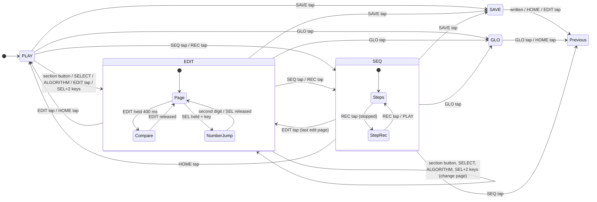

# On-device UI: interaction model

Status: proposal for #39. Eric approves it before the firmware UI is built.
Owner: UX lead (interaction). The UI Designer owns colors, type and mockups,
which come from the screen content lists in [section 6](#6-screen-content-requirements).

This doc says what each control does in each state, what the screen must
show, and which behaviors the tests check. It does not say how anything
looks.

## 1. The inspiration, and the rules

fm1-8p is inspired by mid-80s two-oscillator polysynths, and the JX-8P in
particular. That synth had no knob per parameter. You called a parameter by
its number, its number, name and value showed on the display, and one
data-entry control changed it. An optional programmer gave each parameter its
own control. Parameters were grouped by section: the two oscillators, the
mixer, the filter, the amp, two envelopes, the LFO and the chorus.

fm1-8p keeps that feel:

- **Every patch parameter has a two-digit number.** The tens digit is the
  section (1..8) and the units digit is the parameter (1..8). The numbers are
  fm1-8p's own.
- **A page is four parameters on KNOB1-4,** like a strip of a hardware
  programmer. Each section has one or two pages: units 1-4 are page A and
  units 5-8 are page B.
- **The last parameter you touched is the "focus".** The screen shows it
  large: its number, name and value. This is the one-parameter display from
  the original, and the other three knobs on the page are always live.
- **There are three ways to get to a section quickly:** a section button, the
  ALGORITHM encoder (one section per detent), or typing the number on the keys.

Rules for everything on the device: no Roland names, logos or panel artwork,
and no factory patch names or content from any Roland product. On the device
the sections are called DCO-1, DCO-2, MIX, VCF, VCF ENV, VCA, LFO and CTRL.
Those are generic synth terms. Chorus modes are named SLOW, DEEP and FAST,
not numbered the way the original's were.

## 2. The hardware this uses

From fm1-dock `hb_module.h` (ABI 2). fm1-8p registers with
`HB_F_SCREEN | HB_F_PANEL`:

- **`HB_F_SCREEN`:** the whole 240 x 240 screen is fm1-8p's.
- **`HB_F_PANEL`:** the keys arrive as events, so the sequencer can use them,
  and so do OCT- and OCT+. fm1-8p gives OCT- and OCT+ their usual meaning
  (octave down or up, reported to the host with `key_base`).
- **HOME:** a short press is fm1-8p's (back to PLAY). Holding it for 1.5 s
  still opens the host's module picker, and fm1-8p gets the release first.

| Control | Kind | Notes |
| --- | --- | --- |
| FX, SEL, ENV, LFO, EDIT, GLO, SAVE, ARP, SEQ, PLAY, REC | buttons | each has an LED: 0 off, 1 lit, 2 glow (dim) |
| SELECT, ALGORITHM, KNOB1-4, PRESETS | endless encoders | relative clicks, + is clockwise; \|clicks\| > 1 in one event means a fast turn |
| 27 keys, F3..G5 (key 0..26) | keys | velocity where force is sensed (else 0), aftertouch, one LED each |
| OCT-, OCT+ | buttons | octave, -3..+3 |
| HOME | button | tap: PLAY state; hold 1.5 s: host picker |

The FM-1 has **no bend or mod wheel**. Live bend and mod come only from
MIDI in (pitch bend and CC1). On the panel, they are set per step in the
sequencer.

ARP is **not assigned** in this version. It is kept for the arpeggiator
issue, and its LED stays off.

## 3. Parameter map

Each row gives the number, then page and knob, the engine parameter, the
on-screen label, the value as shown, the step per click, and the fast step.
A fast step is used when one event carries 3 or more clicks.

- **"Pending":** the parameter comes from an open PR or issue. Its knob and
  number are reserved now, so the map does not change when it lands. Until
  then the screen shows `--` and the knob does nothing.
- **"Reserved":** the slot is empty. It shows nothing and the knob does
  nothing.

### 1x DCO-1 (page 1A)

| No. | Knob | Engine parameter | Label | Shown as | Step / fast |
| --- | --- | --- | --- | --- | --- |
| 11 | K1 | `osc1_wave` | WAVE | SAW, PULSE, SQUARE, NOISE | 1 / 1 |
| 12 | K2 | `osc1_octave` | RANGE | 32', 16', 8', 4', 2' (octave -2..+2; 8' = 0) | 1 / 1 |
| 13 | K3 | `osc1_fine_cents` | FINE | -100..+100 ct | 1 / 10 |
| 14 | K4 | `osc1_pulse_width_pct` | WIDTH | 1..99 % (shown inactive unless WAVE is PULSE) | 1 / 5 |

### 2x DCO-2 (page 2A)

| No. | Knob | Engine parameter | Label | Shown as | Step / fast |
| --- | --- | --- | --- | --- | --- |
| 21 | K1 | `osc2_wave` | WAVE | as 11 | 1 / 1 |
| 22 | K2 | `osc2_octave` | RANGE | as 12 | 1 / 1 |
| 23 | K3 | `osc2_fine_cents` | FINE | as 13 | 1 / 10 |
| 24 | K4 | `osc2_pulse_width_pct` | WIDTH | as 14 | 1 / 5 |

### 3x MIX (page 3A)

| No. | Knob | Engine parameter | Label | Shown as | Step / fast |
| --- | --- | --- | --- | --- | --- |
| 31 | K1 | `osc_mix_permille` | MIX | `D1 70 : 30 D2` (0..100, 1 = 10 per mille) | 1 / 5 |
| 32 | K2 | `osc_sync` (pending, PR #31) | SYNC | OFF, ON | 1 / 1 |
| 33 | K3 | `osc_xmod_permille` (pending, PR #31) | X-MOD | 0..100 % | 1 / 5 |
| 34 | K4 | DCO-2 envelope level (pending, #33) | D2 ENV | -- | - |

### 4x VCF (pages 4A and 4B)

All from PR #25 except 46.

| No. | Knob | Engine parameter | Label | Shown as | Step / fast |
| --- | --- | --- | --- | --- | --- |
| 41 | K1 | `filter_cutoff_cents` | CUTOFF | Hz, 3 significant digits (8.18 Hz .. 33.5 kHz); `OPEN` at 14400 | 100 ct / 400 ct |
| 42 | K2 | `filter_resonance_permille` | RESO | 0..100 (100 self-oscillates) | 1 / 5 |
| 43 | K3 | `filter_env_amount_cents` | ENV | -96..+96 st | 1 st / 6 st |
| 44 | K4 | `filter_key_track_permille` | KEY | 0..100 % | 1 / 10 |
| 45 | K1 | `highpass_step` | HPF | OFF, 100 Hz, 240 Hz, 560 Hz | 1 / 1 |
| 46 | K2 | filter velocity amount (pending, #8) | VEL | 0..100 % | 1 / 5 |
| 47 | K3 | reserved | | | |
| 48 | K4 | reserved | | | |

### 5x VCF ENV (page 5A)

| No. | Knob | Engine parameter | Label | Shown as | Step / fast |
| --- | --- | --- | --- | --- | --- |
| 51 | K1 | `filter_env_attack_ms` | ATTACK | time (see below) | time table |
| 52 | K2 | `filter_env_decay_ms` | DECAY | time | time table |
| 53 | K3 | `filter_env_sustain_permille` | SUSTAIN | 0..100 | 1 / 5 |
| 54 | K4 | `filter_env_release_ms` | RELEASE | time | time table |

### 6x VCA (pages 6A and 6B)

| No. | Knob | Engine parameter | Label | Shown as | Step / fast |
| --- | --- | --- | --- | --- | --- |
| 61 | K1 | `amp_attack_ms` | ATTACK | time | time table |
| 62 | K2 | `amp_decay_ms` | DECAY | time | time table |
| 63 | K3 | `amp_sustain_permille` | SUSTAIN | 0..100 | 1 / 5 |
| 64 | K4 | `amp_release_ms` | RELEASE | time | time table |
| 65 | K1 | `amp_velocity_pct` | VEL | 0..100 % | 1 / 5 |
| 66-68 | K2-K4 | reserved | | | |

### 7x LFO (pages 7A and 7B)

| No. | Knob | Engine parameter | Label | Shown as | Step / fast |
| --- | --- | --- | --- | --- | --- |
| 71 | K1 | `lfo_wave` | WAVE | TRI, SAW, SQUARE, RANDOM | 1 / 1 |
| 72 | K2 | `lfo_rate_centihz` | RATE | 0.01..30.0 Hz, 3 significant digits | rate table |
| 73 | K3 | `lfo_delay_ms` | DELAY | time, 0..5.00 s | time table |
| 74 | K4 | `lfo_pitch_cents` | PITCH | 0..1200 ct | 1 to 99 ct: 1 / 10; then 10 / 50 |
| 75 | K1 | `lfo_pw_pct` | PW | 0..49 % | 1 / 5 |
| 76 | K2 | LFO to cutoff depth (pending, #8) | VCF | -- | - |
| 77-78 | K3-K4 | reserved | | | |

### 8x CTRL (pages 8A and 8B)

| No. | Knob | Engine parameter | Label | Shown as | Step / fast |
| --- | --- | --- | --- | --- | --- |
| 81 | K1 | `chorus_mode` | CHORUS | OFF, SLOW, DEEP, FAST | 1 / 1 |
| 82 | K2 | `voice_mode` | MODE | POLY, UNISON | 1 / 1 |
| 83 | K3 | `unison_detune_cents` | DETUNE | 0..100 ct (inactive in POLY) | 1 / 10 |
| 84 | K4 | `bend_range_semitones` | BEND | 0..24 st | 1 / 2 |
| 85 | K1 | wheel adds to vibrato (pending, #41) | W>PITCH | same unit as 74 | as 74 |
| 86 | K2 | wheel adds to PW (pending, #41) | W>PW | same unit as 75 | as 75 |
| 87 | K3 | wheel adds to cutoff (pending, #41 after #8) | W>VCF | same unit as 76 | as 76 |
| 88 | K4 | reserved (aftertouch, later) | | | |

### Units and value tables

- **Time:** the engine stores ms. The screen shows `0 ms` .. `999 ms`, then
  `1.00 s` .. `9.99 s`, then `10.0 s`. A knob click moves one entry in a fixed
  table of about 100 entries from 0 to 10000 ms, spaced about 7 % apart
  above 20 ms: 0, 1, 2, 3, 4, 5, 6, 8, 10, 12, 15, 18, 20, 22 ... 10000. A fast
  turn moves 4 entries. A value that is not in the table, from MIDI or an
  older patch, snaps to the nearest entry on the first click, in the direction
  of the turn.
- **LFO rate:** the same idea, a table from 0.01 Hz to 30.0 Hz, about 6 %
  apart.
- **Cutoff:** shown as Hz from `8.18 * 2^(cents/1200)`, three significant
  digits (`440 Hz`, `1.25 kHz`, `12.0 kHz`). At the top of the range it shows
  `OPEN`, the exact wire of PR #25.
- **The engine's value is the truth.** Values between steps, which only MIDI
  or an older patch can set, show as their nearest rounded value. Nothing
  rewrites them until a knob turns them.
- **Fast turns:** a fast step applies when one event has \|clicks\| >= 3. Each
  click then moves by the fast step. Smaller events move by the normal step
  per click.
- **Clamping:** at the end of a range the value stays put. Encoders never wrap
  a parameter's value. They do wrap pages and sections.

### Page order

The SELECT encoder walks the pages in number order, and wraps at both ends:

`1A, 2A, 3A, 4A, 4B, 5A, 6A, 6B, 7A, 7B, 8A, 8B`

ALGORITHM jumps by section (1..8, wrapping) to the section's page A.

## 4. Buttons and encoders

### Section buttons (in PLAY and EDIT)

Each section button owns a ring of pages. Its **first press** goes to the
ring's first page. Pressing it **again while on its ring** goes to the next
page in the ring, and wraps. The button's LED is lit while one of its pages
is shown, and glows otherwise.

| Button | Ring | Why |
| --- | --- | --- |
| SEL | 1A DCO-1, 2A DCO-2, 3A MIX | the oscillators: "select the source" |
| ENV | 4A VCF, 4B VCF, 5A VCF ENV, 6A VCA, 6B VCA | the filter and amp, with their envelopes |
| LFO | 7A LFO, 7B LFO, 8B WHEEL | modulation |
| FX | 8A CTRL (chorus, voice mode, bend) | the output end |

VCF is the most-edited section, so it comes first on ENV, and the PLAY
screen's knobs are a VCF shortcut too (see [PLAY](#play-the-home-state)).

### Number jump (the original's "call a parameter by number")

In PLAY or EDIT:

1. Hold SEL and tap two white keys.
2. The eight white keys from F3 to F4 (F3, G3, A3, B3, C4, D4, E4, F4) are the
   digits 1..8. While SEL is held, keys make no sound, and those eight key
   LEDs glow as a keypad.
3. After the second digit, fm1-8p goes to that parameter's page and makes it
   the focus.
4. A number with no parameter (a reserved slot) goes to its page, the focus is
   empty, and the screen shows `NO PARAMETER`.
5. Releasing SEL after one digit goes to that section's page A.
6. A SEL tap, pressed and released in under 400 ms with no key in between, is
   the ring step from the table above. It acts on release.

### EDIT: edit page and compare

- **EDIT tap** (under 400 ms):
  - in PLAY: goes to the last edit page shown (4A the first time);
  - in EDIT: goes back to PLAY;
  - in SEQ: goes to the last edit page while the sequencer keeps running.
- **EDIT hold** (400 ms or more), in PLAY or EDIT: **compare**.
  - While it is held, the stored patch sounds and the screen shows its values.
  - Knobs are ignored, and a turn shows `COMPARE: RELEASE EDIT TO CHANGE`.
  - Releasing EDIT puts the edit buffer back, exactly as it was.
  - With no edits, a hold shows `NO EDITS` and changes nothing.
- **EDIT LED:** lit while the edit buffer differs from the stored patch. It
  blinks during compare, and glows when there are no edits.

### PRESETS: patch browsing

- **In PLAY and EDIT:** each click loads the next or previous patch at once
  (a fast turn moves 4). Patch numbers wrap. The page you are on stays, so you
  can compare a section across patches.
- **Unsaved edits:** when the edit buffer is modified, the first click does
  not load anything. It shows `EDITED: TURN AGAIN TO DISCARD`. Another click
  in the same direction within 2 s discards the edits and loads. Anything
  else cancels the warning. See question Q4.
- **In SAVE:** PRESETS picks the destination slot.
- **In GLO and SEQ:** PRESETS browses patches as in PLAY. In SEQ, while the
  sequencer is playing, the rules in
  [Patch change while the sequencer plays](#patch-change-while-the-sequencer-plays)
  apply.

### SAVE

1. **SAVE tap** in PLAY, EDIT or SEQ opens SAVE.
   - The destination starts at the current slot.
   - The name is the current one.
2. **In SAVE:**
   - PRESETS: the destination slot. It shows the name of what is there now, or
     `EMPTY`.
   - SELECT: moves the name cursor.
   - KNOB1: the character at the cursor (A-Z, 0-9, space, `-`).
   - KNOB2: inserts or deletes at the cursor. Clockwise inserts a space, and
     counterclockwise deletes.
   - The other buttons do nothing and their LEDs are off.
3. **SAVE tap again** writes the patch. If the destination holds another
   patch, the first tap shows `REPLACE 23 <NAME>? SAVE AGAIN`, and the second
   tap writes.
4. **After the write:** it shows `SAVED 23` for 1.5 s, the edit buffer becomes
   clean, and the state goes back to where SAVE was pressed.
5. **Cancel:** HOME tap or EDIT tap. Nothing is written.
6. **A write erases a flash bank,** which stalls the sound for about 100 ms.
   - If any voice is sounding or the sequencer is playing, the write waits. It
     shows `SAVING WHEN SILENT`, and is written on the first silent moment.
   - A third SAVE tap writes at once anyway. See question Q5.
   - A failed write shows `SAVE FAILED` and keeps the edit buffer dirty.

The patch includes its sequencer pattern if #40 stores patterns with patches.
See question Q2.

### GLO: global settings

GLO holds settings for the instrument, not for a patch. They are kept in the
module's settings record, and saved 2 s after the last change once nothing
is sounding, as fm1-dock's rules ask.

- GLO tap opens GLO. GLO tap or HOME tap goes back to the previous state.
- SELECT and ALGORITHM move between the GLO pages, and KNOB1-4 edit them.
- Numbers have a `G` prefix so they are never confused with patch
  parameters.

| No. | Knob | Setting | Shown as | Default |
| --- | --- | --- | --- | --- |
| G11 | K1 | MIDI channel in | 1..16, ALL | ALL |
| G12 | K2 | MIDI channel out | 1..16 | 1 |
| G13 | K3 | Clock source | AUTO, INT, MIDI | AUTO |
| G14 | K4 | Clock out | OFF, ON | OFF |
| G21 | K1 | CC receive | OFF, ON | ON |
| G22 | K2 | CC send (knob moves go out as CC) | OFF, ON | OFF |
| G23 | K3 | Program change | OFF, RECV, SEND, BOTH | RECV |
| G24 | K4 | External CC response | JUMP, PICKUP | JUMP (Q6) |
| G31 | K1 | Velocity curve (the host's `sense_set` curve) | 50..200 % | the host's |
| G32 | K2 | Fixed velocity, for keys with no force sensing | 1..127 | 100 |
| G33 | K3 | Key LEDs follow played notes | OFF, ON | ON |
| G34 | K4 | reserved | | |

**Clock source:**

- **AUTO:** follows MIDI clock when it arrives, and goes back to the internal
  clock after it stops (the behavior #38 builds).
- **INT:** ignores MIDI clock.
- **MIDI:** only MIDI clock. With no clock coming in, the sequencer waits.

### Transport and sequencer buttons

PLAY, SEQ and REC are described in [section 5](#5-sequencer).

OCT- and OCT+ shift the keys by an octave, in every state. That includes REC
step entry, where the octave sets the pitch that is written.

### Encoders summary

| Encoder | PLAY | EDIT | SEQ | SAVE | GLO |
| --- | --- | --- | --- | --- | --- |
| SELECT | page (goes to EDIT) | page | step cursor | name cursor | GLO page |
| ALGORITHM | section (goes to EDIT) | section | SEQ page | - | GLO page |
| KNOB1-4 | performance knobs | page's parameters | SEQ page's values | K1 char, K2 insert/delete | settings |
| PRESETS | patch | patch | patch | destination slot | patch |

## 5. Sequencer

This follows #35-#42: 16 steps, and each step holds a note, a chord (up to the
voice count), a tie or a rest. Each step also has a velocity, a bend and mod
value, and a jump or glide move.

### Keys and LEDs

- **Steps 1-16 are keys 0-15** (F3..G#4: all keys, black and white, in a
  row). Keys 16-26 have no step.
- **The keys always play notes.** In SEQ view their LEDs show the pattern, and
  holding **SEQ** turns them into step selectors.
  - So a chord can be played anywhere on the keyboard, including over the step
    keys.
  - #39's first idea was "hold a chord and press a step key". That needs the
    step keys to be silent, which costs 16 of the 27 keys. See question Q1.

Key LED states in SEQ view, keys 0-15:

| Step | LED |
| --- | --- |
| past the pattern length | off |
| rest or empty, within the length | glow |
| note or chord | lit |
| tie | lit, with a short off blink every 500 ms |
| cursor (stopped, or in REC) | blinks between lit and glow at 4 Hz |
| playhead (playing) | the step's state inverted for the step's length: lit becomes off, glow or off becomes lit |

- Keys 16-26 are off in SEQ view, unless G33 is on and the key is held.
- **Outside SEQ view,** while the sequencer plays: only the playhead key is
  lit. Held notes are also lit if G33 is on.
- **When stopped, outside SEQ view:** held notes are lit if G33 is on, and
  everything else is off.

Button LEDs:

- **SEQ:** lit in SEQ view, and glows otherwise.
- **PLAY:** lit while playing, with a short dark flash on each beat. Glows
  when stopped. Blinks when it is waiting for external clock.
- **REC:** lit while step record is armed, and glows otherwise.

### SEQ view

SEQ tap goes to SEQ view. SEQ tap in SEQ view goes back to the state SEQ was
pressed from. In SEQ view:

- **SELECT** moves the step cursor (1..length, wraps), and the screen shows
  that step.
- **SEQ held + key 0-15** moves the cursor to that step. Without REC, it also
  plays the step's notes once, as an audition.
- **ALGORITHM** picks the SEQ page:

| Page | K1 | K2 | K3 | K4 |
| --- | --- | --- | --- | --- |
| S1 PATTERN | TEMPO 30..300 BPM (step 1, fast 10) | LENGTH 1..16 | SWING 50..75 % | GATE 5..100 % |
| S2 STEP (the cursor's step) | VEL 1..127 | BEND -100..+100 % of the bend range (and the semitones it gives) | MOD 0..127 | MOVE JUMP, GLIDE |
| S3 PLAY | TRANSPOSE -24..+24 st | KEY TRANSPOSE OFF, ON | - | - |

- **TEMPO under external clock:** TEMPO shows the measured tempo and
  `MIDI CLOCK`. Turning it shows `TEMPO FOLLOWS MIDI CLOCK` and changes
  nothing.
- **On a rest step,** S2 shows that step's values but marks them inactive.
  Rests and ties keep the bend and mod they had (#42).
- **Section buttons mean something else in SEQ view.** They are steps, not
  sections, and the screen labels them:

| Button | Not in REC | In REC (step record) |
| --- | --- | --- |
| SEL | clear the cursor step (make it a rest) | write a REST, advance |
| SEL held 1.5 s | clear the whole pattern (the saved copy stays until SAVE) | - |
| ENV | toggle TIE on the cursor step | write a TIE, advance |
| LFO | toggle JUMP or GLIDE on the cursor step | same |
| FX | unassigned | step back one step, without writing |

### Step record (REC)

1. **Arming:** REC tap while stopped arms step record. If you are not in SEQ
   view, it goes there. The cursor stays where it is, and the REC LED is lit.
2. **Building a step:** play a note or chord. Each key down sounds and joins
   the step being built.
3. **Writing:** when the last held key is released, the step is written at the
   cursor and the cursor advances (and wraps at the length).
   - **Notes:** the keys that were held, with the octave applied. Only as many
     as the voice count are kept, the first ones pressed. The rest are
     dropped, and the screen shows `MAX 6 NOTES`.
   - **Velocity:** the highest velocity among the step's notes. A key with no
     force sensing uses G32.
   - **Bend and mod:** the live MIDI-in pitch bend and CC1 at the moment of
     writing (#42). With no MIDI controller, these are center and 0.
4. **Rests, ties and going back:** SEL writes a rest, ENV writes a tie, and FX
   steps back.
5. **Leaving:** REC tap disarms.
6. **PLAY while armed:** the sequencer starts and REC disarms, so a performance
   doesn't record over the pattern. Live recording while playing is not in
   this version. See question Q3.

### Playing

- **PLAY** starts from step 1, or stops. It works in every state, including
  SAVE and GLO. It acts on **press**, not release, so it is on time.
- **Stopping:**
  - note-offs go out for everything the sequencer started;
  - bend returns to center and mod returns to the live wheel (#42);
  - with G14 on, MIDI stop goes out.
- **Starting** sends MIDI start, with G14 on.
- **Clock source MIDI** (G13) or AUTO with clock present:
  - a PLAY press with no clock running arms the start: PLAY blinks, and the
    sequencer starts on the next MIDI start or continue;
  - a second press disarms.
  - MIDI start, stop and continue act as #38 says, whatever the PLAY LED shows.
- **Transpose:** S3 TRANSPOSE sets an offset.
  - With KEY TRANSPOSE on and the sequencer playing, a key press does not
    sound. It sets the transpose to the key minus C4, at the next step (#37).
  - Releasing the key keeps the transpose.
  - When stopped, keys play normally.
- **Bend and mod per step (#42):**
  - JUMP steps set their bend and mod at the step start.
  - GLIDE steps ramp from the previous step's values to their own by the step
    end.
  - Live MIDI bend and CC1 still reach the engine while the sequencer plays;
    the newest value wins until the next step sets its own. See question Q7.

### Editing during playback

All of PLAY, EDIT, GLO and SEQ stay usable while the sequencer plays.

- **Sound edits** reach the engine at once. They are smoothed by #3.
- **Step edits:** an edit to a step (S2, SEL or ENV) takes effect the next time
  that step plays. A step that is sounding is not cut.
- **Pattern settings:**
  - LENGTH shorter than the playhead: the playhead wraps to step 1 at the next
    step.
  - TEMPO changes take effect at the next step.
  - SWING and GATE apply from the next step.

### Patch change while the sequencer plays

Only relevant if patterns are stored with patches (Q2):

- the new patch's **sound** loads at once;
- its **pattern** takes over at the end of the current pass of the running
  pattern, at its step 16 or its length.
- Until then the screen shows `NEXT PATTERN: 23`. See question Q8.

## 6. Screen content requirements

This is for the UI Designer. It lists what each state must show, in priority
order, and says nothing about the look. "Must" items are needed to use the
synth, and "should" items help.

Everywhere, unless the state says otherwise:

- **Must:** the current patch number and name, with an EDITED marker when the
  edit buffer differs from the stored patch.
- **Must:** a transport indicator: STOPPED, PLAYING with the step number, or
  WAITING FOR CLOCK. Also the clock source in use, INT or MIDI, and the tempo.
- **Must:** a banner line for short messages, shown 1.5 s:
  - `SAVED 23`
  - `EDITED: TURN AGAIN TO DISCARD`
  - `MAX 6 NOTES`
  - `NO EDITS`
  - `NO PARAMETER`
  - `SAVING WHEN SILENT`
  - `SAVE FAILED`
  - `TEMPO FOLLOWS MIDI CLOCK`
  - `COMPARE: RELEASE EDIT TO CHANGE`
  - `NEXT PATTERN: 23`
- **Should:** the number of sounding voices, out of the voice count.
- **Should:** a MIDI-in activity mark that flashes for 100 ms on any message.

### PLAY (the home state)

- **Must:** the patch number and name, large.
- **Must:** the four performance knobs, each with its number, label and value:
  K1 41 CUTOFF, K2 42 RESO, K3 43 ENV, K4 64 RELEASE.
- **Must:** the focus readout (number, section, label, value) after a knob is
  turned, cleared after 3 s of no turns.
- **Should:** a hint that EDIT opens the edit pages and that section buttons
  jump to sections.

### EDIT (a parameter page)

- **Must:**
  - the section name and number (`4 VCF`);
  - the page (A or B) and how many pages the section has;
  - where the page sits in the full page order (for example, 5 of 12).
- **Must:** for each of the four knobs:
  - its number, label and value as shown in the map;
  - a marker for an inactive value (14 WIDTH when WAVE isn't PULSE, 83
    DETUNE in POLY);
  - `--` for a pending parameter, and nothing for a reserved one.
- **Must:** the focus parameter, large. This is the one-parameter display:
  number, section, full label and value, with its unit.
- **Should:** the focus value's position in its range, for any parameter that
  has a range rather than a list of choices.
- **Should:** the knob position on the page (K1..K4) next to each value, so
  the physical knob is obvious.
- **Must**, while SEL is held for a number jump:
  - the digits typed so far (`4_`);
  - the eight sections by number and name;
  - that the white keys F3-F4 are 1-8.
- **Must**, while EDIT is held for compare: a clear COMPARE marker, and the
  values shown are the stored patch's.

### SAVE

- **Must:**
  - the destination slot number;
  - the name currently in that slot, or EMPTY;
  - the new name with the cursor position;
  - the step: editing, confirm replace, waiting for silence, saved, or failed.
- **Must:** which controls do what: PRESETS for the slot, SELECT for the
  cursor, K1 for the character, K2 for insert or delete, SAVE to write, HOME to
  cancel.

### GLO

- **Must:** that this is the global page. Global settings are not part of the
  patch.
- **Must:** the page and the four settings, each with its G-number, label and
  value.

### SEQ view

- **Must:** a 16-step strip. For each step: rest, note, chord or tie, and
  whether it is past the length. Also the cursor, and the playhead while
  playing. It mirrors the key LEDs.
- **Must:** the cursor step in detail:
  - its notes by name, `C4 E4 G4`, up to the voice count;
  - or REST or TIE;
  - its velocity, bend (% and semitones), mod, and JUMP or GLIDE.
- **Must:** the SEQ page (S1, S2 or S3) and its four knob values.
- **Must:** step record armed or not. While armed, the notes held so far for
  the step being built.
- **Must:** the meaning of SEL, ENV, LFO and FX in SEQ view (REST, TIE, MOVE,
  BACK), since it differs from the other states.
- **Must:** the transpose, when it isn't 0.
- **Should:** the tempo source and tempo next to the strip.

### Back from the host's picker

`draw(full)` redraws the whole state, and every LED is sent again. The state
is the one fm1-8p was in when it was left, but the sequencer is stopped:
`release()` cuts notes.

## 7. Navigation states

- **Previous** means the state that SEQ, SAVE or GLO was entered from.
- **Compare and number jump** also exist in PLAY, and work the same there.
- **The transport** runs alongside every state: STOPPED, PLAYING, or
  WAITING-FOR-CLOCK. PLAY toggles it from any state.
- **HOME held 1.5 s** leaves fm1-8p for the host's picker from any state.

### What each button does in each state

| Button | PLAY | EDIT | SEQ | SAVE | GLO |
| --- | --- | --- | --- | --- | --- |
| SEL | tap: DCO ring; hold: number jump | same | REST or clear step; hold 1.5 s: clear pattern | - | - |
| ENV | VCF/VCA ring | same | TIE | - | - |
| LFO | LFO ring | same | JUMP or GLIDE | - | - |
| FX | CTRL page | same | BACK (in REC) | - | - |
| EDIT | tap: last edit page; hold: compare | tap: PLAY; hold: compare | tap: last edit page | cancel | - |
| GLO | GLO | GLO | GLO | - | back |
| SAVE | SAVE | SAVE | SAVE | write, or confirm | - |
| ARP | - | - | - | - | - |
| SEQ | SEQ view | SEQ view | tap: back; hold: keys select steps | - | - |
| PLAY | start/stop | start/stop | start/stop | start/stop | start/stop |
| REC | arm, go to SEQ | arm, go to SEQ | arm or disarm | - | - |
| HOME tap | - | PLAY | PLAY | cancel | back |
| OCT-/+ | octave | octave | octave | octave | octave |

"-" means the button does nothing in that state, and its LED is off. A button
that does something glows, unless it is lit for its own reason.

## 8. Edge cases

### Knob pickup vs. jump

- **The panel's encoders are relative,** so on the device there is no pickup
  problem. A turn always moves from the current value, and loading a patch
  never makes a knob "out of place".
- **External absolute controllers are the issue:** a CC from another device
  sets a value 0..127, which is scaled to the parameter's range.
  - With G24 = JUMP, the value is set at once.
  - With G24 = PICKUP, an incoming CC is ignored until it crosses or lands on
    the current value, within one CC step. After that it follows. The pickup
    state resets for every parameter when a patch loads.
  - A value that is ignored still shows on the screen as `CC 74: 52 (PICKUP)`
    in the banner.
- **Choice parameters** (WAVE, MODE, CHORUS, HPF) split 0..127 into equal
  bands, and are never picked up.

### MIDI CC arriving while a page is shown

- The value changes in the engine and in the edit buffer, and the edit buffer
  becomes EDITED.
- If the parameter is on the page shown, its value redraws. The screen redraws
  at most 30 times a second, and always shows the latest value.
- The **focus does not move** to a parameter changed by MIDI, so a DAW
  automating cutoff doesn't steal the big readout from what you are editing.
- **During compare,** CCs go to the edit buffer, not the stored patch. The
  screen keeps showing the stored values until EDIT is released, then shows
  the edit buffer with the CC changes.
- **During SAVE,** CCs still change the sound. The patch is saved with the
  values at the moment of the write.
- **Program change** (with G23 RECV or BOTH) loads the patch at once,
  discarding edits without the PRESETS warning. A remote device asked for it.

### Editing during sequencer playback

See [Editing during playback](#editing-during-playback). Also:

- Changing voice mode or chorus mode while a pattern plays is allowed. The
  engine already handles a mode switch with sounding voices.
- A chord step with more notes than the voice count can't exist. Entry stops
  at the voice count.
- If the voice count is lowered later, playback uses only the first notes of
  each step.

### Keys that change meaning while held

- Each held key remembers how it started: a played note, a step select, a
  number digit or a transpose.
- Its release is handled the same way, even if the modifier (SEL, SEQ) was let
  go in between.
- A note started before SEL or SEQ was pressed still gets its note-off when
  the key comes up.

### Leaving the module

- `release()` stops the sequencer and cuts every note.
- The edit buffer, the current page, the SEQ cursor and the current state are
  kept in RAM. If the host reloads the module, they come from the settings
  record (Q4).

### Taps and holds

- **Tap or hold:** a press shorter than 400 ms is a tap; 400 ms or more is a
  hold.
- **Buttons that act on press:** PLAY, REC, SAVE, GLO, ENV, LFO and FX, since
  they have no hold meaning in that state.
- **Buttons that act on release:** SEL and EDIT, in the states where they have
  a hold meaning. SEQ acts on release only if no step key was pressed while it
  was held.
- **Two buttons at once:** only SEL+key, SEQ+key and HOME are combinations.
  Any other button pressed while one is held acts on its own.

## 9. Acceptance behaviors

These are testable on the desktop if the UI logic is a plain C module, kept
apart from `hb_host_t`. Events go in with a time (`ui_event(ev, arg, ms)`).
What comes out is engine calls (set param, note on and off, bend, CC1), LED
states, transport commands, flash writes, and a view model. The view model is
what the screen must show (section 6), not pixels. Each line below is one
test.

**Navigation**

1. From PLAY, ENV tap shows page 4A. ENV again shows 4B, then 5A, 6A, 6B and
   back to 4A.
2. From page 7B, SEL tap shows 1A, the first page of SEL's ring, not the next
   page.
3. SELECT +1 from 8B shows 1A, and SELECT -1 from 1A shows 8B.
4. ALGORITHM +1 from 4B shows 5A, the next section's page A.
5. Holding SEL, tapping keys A3 then G3 (digits 3, 2), then releasing SEL
   shows 3A with 32 SYNC as the focus. No note-on is sent for those keys.
6. Holding SEL, tapping C4 (digit 5) and releasing SEL shows 5A, and the
   focus is empty.
7. Number 47 (reserved) shows page 4B, the focus is empty, and the banner is
   `NO PARAMETER`.
8. EDIT tap in PLAY shows the last edit page, and 4A on a fresh start. EDIT
   tap in EDIT shows PLAY.
9. HOME tap in SAVE writes nothing and returns to the state SAVE came from.

**Values**

10. A KNOB1 +1 on page 4A raises `filter_cutoff_cents` by 100. An event of
    +3 raises it by 1200, which is 3 x 400.
11. A knob turn past the top of a range leaves the value at its maximum. Pages
    wrap, values don't.
12. An attack time of 13 ms (not in the table) turned +1 becomes the next
    table entry above 13, and turned -1 becomes the next entry below.
13. Turning a knob on a pending or reserved slot sends no engine call.
14. A knob turn makes that parameter the focus. A MIDI CC to another parameter
    does not change the focus.
15. Cutoff 14400 shows `OPEN`, and 6900 shows `440 Hz`.

**Compare, edits and save**

16. After an edit, holding EDIT for 400 ms sends the stored patch's values to
    the engine. Releasing it sends the edit buffer's values back, and the
    engine's parameters then equal the edit buffer exactly.
17. Holding EDIT with no edits sends no engine calls and shows `NO EDITS`.
18. Knob turns during compare change nothing.
19. With an edited buffer, one PRESETS click loads nothing and shows the
    discard warning. A second click in the same direction within 2 s loads the
    next patch. After 2 s, a click shows the warning again.
20. SAVE, then SAVE onto an occupied slot, asks to confirm. A third SAVE
    writes. Onto the current or an empty slot, the second SAVE writes.
21. A SAVE confirmed while a voice is sounding writes nothing until the voices
    are silent, then writes once.
22. After a write, EDITED is clear and the EDIT LED glows.

**Sequencer**

23. PLAY sends the sequencer start on press, from every state. PLAY again
    stops it, and every note it started gets a note-off.
24. In REC, holding C4 and E4, then releasing both, writes one step with those
    two notes at the cursor, and the cursor moves +1.
25. In REC with a 6-voice count, holding 8 keys writes the first 6 pressed and
    shows `MAX 6 NOTES`.
26. In REC, SEL writes a rest and ENV writes a tie, and each advances the
    cursor. FX moves the cursor back without writing.
27. In REC, a key with velocity 0 (unsensed) writes the step with G32's
    velocity.
28. In REC with MIDI bend at +4096 and CC1 at 64, the written step holds bend
    +4096 and mod 64.
29. PLAY while REC is armed starts playback and disarms REC.
30. Holding SEQ and pressing key 5 moves the cursor to step 6 with no note-on
    sent while stopped in REC. Without REC it auditions step 6's notes.
31. Key LEDs in SEQ view, for a 12-step pattern with notes on 1 and 5 and a
    tie on 6: key 0 lit, key 4 lit, key 5 tie-blink, keys 1-3 and 6-11 glow,
    keys 12-15 off.
32. While playing, the playhead key's LED is inverted for exactly its step, and
    the other keys keep their states.
33. With KEY TRANSPOSE on and playing, pressing D4 sends no note-on and sets
    transpose +2 from the next step.
34. With G13 = MIDI and no clock, PLAY sets WAITING FOR CLOCK and sends no
    notes. MIDI start then starts the sequencer from step 1.
35. A tempo knob turn under external clock changes nothing and shows the
    banner.
36. Setting LENGTH to 4 while the playhead is on step 9 plays step 1 next.

**Keys and MIDI**

37. A key pressed before SEL is held, and released while SEL is held, sends
    its note-off.
38. With G24 = PICKUP and cutoff at 64 (CC scale), CC74 = 20 is ignored, and
    CC74 = 63, 64 or 65 takes over. After that, CC74 = 20 sets the value.
39. With G24 = JUMP, CC74 = 20 sets cutoff at once.
40. A CC during compare reaches the edit buffer. On EDIT release, the engine
    has the CC's value.
41. Program change 5 loads patch 5 even with an edited buffer, when G23 is RECV
    or BOTH.
42. After `release()`, then `draw(full)`, every LED is sent again and the
    transport is STOPPED.

## 10. Open questions for Eric

These are listed in the PR description. They are not decided here, and the
default in each is the recommended option.

- **Q1:** step key layout.
- **Q2:** where patterns are stored.
- **Q3:** live recording.
- **Q4:** unsaved edits on patch change, and the edit buffer at power-off.
- **Q5:** SAVE while sound is playing.
- **Q6:** external CC response.
- **Q7:** live MIDI bend and mod during per-step bend and mod.
- **Q8:** patch change while the sequencer plays.
- **Q9:** patch slot numbering.
- **Q10:** coarse tune for DCO-2.
